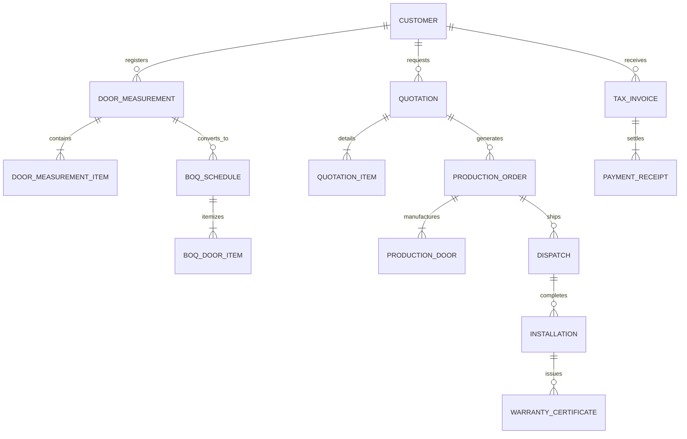

# EXMARK ERP — Database Migration & Schema Guide

**Supabase PostgreSQL Architecture, Pooler Settings & Non-Destructive Migrations**

---

## 1. Relational Schema Architecture (29 Models)

The EXMARK ERP schema is defined in [`prisma/schema.prisma`](file:///c:/Users/NAZER%20KARUMBAN/EXMARK-Projects/exmark-erp/prisma/schema.prisma) across 8 core domains:

### Table Inventory:
1. **Access & Security:** `Role`, `Permission`, `RolePermission`, `User`, `Employee`, `Session`, `AuditLog`
2. **Sales & Engineering:** `Customer`, `Lead`, `LeadFollowUp`, `DoorMeasurement`, `DoorMeasurementItem`, `ProductCategory`
3. **Estimation & Orders:** `BOQSchedule`, `BOQDoorItem`, `Quotation`, `QuotationItem`, `ProductionOrder`, `ProductionDoor`
4. **Supply Chain:** `InventoryItem`, `StockMovement`, `PurchaseOrder`, `PurchaseOrderItem`
5. **Logistics & After-Sales:** `Dispatch`, `Installation`, `WarrantyCertificate`
6. **Finance & Strategy:** `TaxInvoice`, `PaymentReceipt`, `SalesTarget`

---

## 2. Migration Execution Modes

### Mode A: Automated Cloud Build Runner (Recommended)
Embedded in [`scripts/deploy-migrate.mjs`](file:///c:/Users/NAZER%20KARUMBAN/EXMARK-Projects/exmark-erp/scripts/deploy-migrate.mjs).
- Runs during Render's build pipeline.
- Uses `DIRECT_URL` (Port 5432 session pooler).
- Executes `npx prisma migrate deploy`.

### Mode B: Authenticated Remote API Trigger
Protected endpoint at [`/api/system/migrate`](file:///c:/Users/NAZER%20KARUMBAN/EXMARK-Projects/exmark-erp/app/api/system/migrate/route.ts).
- `GET`: Inspects public table count and migration status safely.
- `POST`: Triggers `npx prisma migrate deploy` on the live container.
- Required Header: `Authorization: Bearer <AUTH_SECRET>`.

### Mode C: Secure Local Workstation Migration
Using [`scripts/check-staging-migration.ts`](file:///c:/Users/NAZER%20KARUMBAN/EXMARK-Projects/exmark-erp/scripts/check-staging-migration.ts).
- Reads `.env.staging.local` (gitignored).
- Runs `cmd /c npx prisma migrate status`.
- Applies reviewed forward-only DDL without exposing credentials in logs.

---

## 3. Non-Destructive DDL Guarantee

The reviewed initial migration [`prisma/migrations/20261028000000_init/migration.sql`](file:///c:/Users/NAZER%20KARUMBAN/EXMARK-Projects/exmark-erp/prisma/migrations/20261028000000_init/migration.sql):
- Uses `CREATE TABLE IF NOT EXISTS` for all tables.
- Contains **0 `DROP TABLE`**, **0 `DROP COLUMN`**, and **0 `TRUNCATE`** statements.
- Preserves all existing business data.
