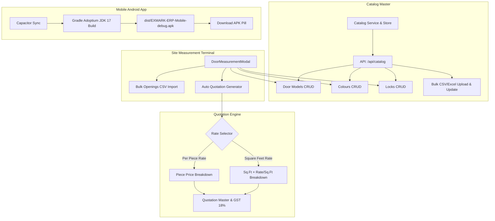

# Implementation Plan: Site Measurement Dynamic Catalog (Models, Colours, Locks), Bulk Upload & Update, Dual-Rate Auto Quotation, and Native Android APK

## Goal Description
Extend the EXMARK ERP Site Measurement system to provide:
1. **Dynamic Catalog Management (Add, Edit, Delete):** Full CRUD for Door Models, Colours/Finishes, and Locks with persistence in `data/catalog-store.json` and PostgreSQL.
2. **Bulk Upload & Update Engine:** Support bulk import and update via CSV/Excel for Catalog items (Models, Colours, Locks) and Site Door Openings (multi-door sheets).
3. **Dual-Rate Auto Quotation Engine:** Direct conversion from Site Measurements to GST Quotations supporting both **Per Piece Rate** and **Square Feet Rate** with real-time tax calculation (18% GST, HSN 3925.20.00).
4. **Updated Mobile Android APK:** Build and bundle the updated native Android APK using Capacitor and Adoptium OpenJDK 17, downloadable directly via the field terminal `[⬇️ Download APK]` action pill.

---

## User Review Required

> [!IMPORTANT]
> **Pricing Engine Rules for Auto Quotation:**
> - **Per Piece Rate Mode:** Calculates opening price using: $\text{Base Piece Price} + \text{Lock Surcharge} + \text{Price Adjustment}$.
> - **Square Feet Rate Mode:** Calculates opening price using: $(\text{Opening Area in Sq.Ft} \times \text{Model Rate/Sq.Ft}) + \text{Lock Surcharge} + \text{Price Adjustment}$.
> - Both modes will be available as a toggle in the **Auto Quotation Generator Modal**, allowing side-by-side profit & rate comparison before finalizing.

> [!NOTE]
> **Bulk Upload Format:**
> - A downloadable CSV/Excel template will be provided for Door Openings and Catalog items.
> - When importing, rows matching an existing ID or Door Number will be updated; new ones will be created.

---

## Proposed Changes



---

### Component 1: Catalog Data Layer & APIs

#### [NEW] `types/catalog.ts`
Define strong TypeScript interfaces for catalog entities:
- `DoorModelCatalogItem`: `id`, `code`, `name`, `category`, `basePrice` (piece rate), `ratePerSqFt`, `defaultThickness`, `isActive`, `description`.
- `ColourCatalogItem`: `id`, `code`, `name`, `finishType`, `hexColor`, `isActive`.
- `LockCatalogItem`: `id`, `name`, `lockType`, `price`, `description`, `isActive`.
- `CatalogMaster`: Container with all three collections and version tracking.

#### [NEW] `lib/services/catalogService.ts`
- Persistent store at `data/catalog-store.json` seeded with existing standard models (`EXM-A-100`, `EXM-A-101`, `EXM-B-200`, `EXM-D-300`, etc.), finishes, and locks.
- Synchronizes with PostgreSQL or file store.
- CRUD operations: `listCatalog`, `saveModel`, `deleteModel`, `saveColour`, `deleteColour`, `saveLock`, `deleteLock`.
- Bulk upsert operations: `bulkUploadCatalog(type, items)` handling create or update by ID/code.

#### [NEW] `app/api/catalog/route.ts` & `app/api/catalog/[entity]/route.ts`
- `GET /api/catalog` — returns all models, colours, and locks.
- `POST /api/catalog/[entity]` — create or update an item.
- `DELETE /api/catalog/[entity]/[id]` — delete an item with safeguard against deleting items used in active orders.
- `POST /api/catalog/bulk` — bulk upload and upsert handler for CSV/JSON.

---

### Component 2: Bulk Upload & Update Engine

#### [NEW] `lib/utils/bulkUploadParser.ts`
- CSV and JSON parser for:
  1. Door Models, Colours, and Locks.
  2. Site Measurement Door Openings (`DoorItemInput[]`).
- Validation: checks for positive dimensions, valid unit (`CM`, `INCH`, `MM`), valid fractions, and formats errors cleanly.
- Export sample CSV templates generator for catalog and door openings.

#### [NEW] `components/modules/catalog/CatalogManagerModal.tsx`
- Modal accessible from both the Site Measurement Terminal and Admin Settings.
- 3 Tabs: **Door Models**, **Colours & Finishes**, **Locks & Hardware**.
- Add New / Edit / Delete buttons with live table.
- **Bulk Upload & Update** section: File drag & drop, template download, validation error display, and live preview before saving.

---

### Component 3: Site Measurement Terminal Integration

#### [MODIFY] `components/modules/DoorMeasurementModal.tsx`
- Replace hardcoded `DOOR_MODELS_CATALOG`, `COLOURS`, and `LOCK_OPTIONS` with dynamic state loaded from `/api/catalog` (with static fallback for instant offline rendering).
- Add button in the top action bar: `[⚙️ Catalog Master]` to open `CatalogManagerModal` inline.
- Add button in the openings tab rail: `[📥 Bulk Upload Openings]` to upload CSV/Excel files with 10–100 doors directly into the active measurement sheet.
- Add button in the footer actions: `[⚡ Auto Quotation]` opening the dual-rate quotation generator.

---

### Component 4: Dual-Rate Auto Quotation Engine

#### [NEW] `app/api/measurements/[id]/convert-to-quotation/route.ts`
- Endpoint accepting:
  - `measurementId` (or full measurement payload)
  - `pricingStrategy`: `'PER_PIECE'` | `'PER_SQFT'` | `'BLENDED'`
  - `customRates` (optional overrides per door or model)
  - `discount` (percentage or amount)
- Creates formal Quotation with:
  - Quotation items populated from door openings.
  - Itemized display of Area (Sq.Ft), Rate per Sq.Ft or Rate per Piece, Surcharges (Locks/Finishes), and Line Totals.
  - Standard GST calculation (18% HSN 3925.20.00: 9% CGST + 9% SGST for Kerala).
  - Cross-reference link between Quotation (`QTN-2026-XXX`) and Site Measurement (`MSR-2026-XXX`).

#### [NEW] `components/modules/measurements/AutoQuotationModal.tsx`
- Interactive modal triggered from the Site Measurement:
  - Toggle between **Per Piece Rate** and **Square Feet Rate**.
  - Side-by-side comparison summary:
    - Total Square Footage vs Total Pieces.
    - Gross Subtotal under both methods.
    - Net Total including 18% GST.
  - One-click "Generate Formal Quotation" button with direct redirect to Quotation view or WhatsApp PDF sharing.

#### [MODIFY] `components/modules/ModuleViews.tsx`
- Add "⚡ Auto Quotation" button on each Site Measurement card in the measurement book list for one-click quotation generation without having to open the editor.

---

### Component 5: Updated Native Android APK Build

#### Build and Package Process:
1. Ensure `capacitor.config.ts` has the latest endpoints and assets.
2. Run `npx cap sync android` to sync web assets and plugins.
3. Execute Gradle build using Adoptium OpenJDK 17:
   ```powershell
   $env:JAVA_HOME = "C:\Program Files\Eclipse Adoptium\jdk-17.0.20.101-hotspot"
   $env:ANDROID_HOME = "C:\Users\NAZER KARUMBAN\AppData\Local\Android\Sdk"
   cd android; .\gradlew.bat assembleDebug
   ```
4. Copy the compiled debug APK (`android/app/build/outputs/apk/debug/app-debug.apk`) to:
   - `dist/EXMARK-ERP-Mobile-debug.apk`
   - `public/dist/EXMARK-ERP-Mobile-debug.apk`
5. Verify download link in `DoorMeasurementModal.tsx` and Navbar.

---

## Verification Plan

### Automated Tests
1. **Catalog CRUD & Bulk Upload Test Suite (`scripts/test-catalog-crud.ts`):**
   - Test adding, editing, and deleting door models, colours, and locks.
   - Test bulk CSV upload and upsert functionality with sample data.
2. **Auto Quotation Dual-Rate Test Suite (`scripts/test-auto-quotation.ts`):**
   - Test converting a site measurement with 4 openings into a quotation using **Per Piece Rate**.
   - Test converting the same measurement using **Square Feet Rate**.
   - Verify GST 18% computation, subtotal, and cross-linking.
3. **Master Test Suite:**
   - Run `npm.cmd run test:master` to ensure all existing Phase 1–9 tests continue passing.

### Manual Verification
1. **Catalog CRUD:** Open Site Measurements, click `[⚙️ Catalog Master]`, add a custom model `EXM-SUPER-500`, custom colour `Kerala Royal Rosewood`, and custom lock `Fingerprint Bio Lock (+₹1500)`. Verify they immediately appear in the dropdowns.
2. **Bulk Upload:** Upload a sample CSV with 5 door openings. Confirm all 5 openings appear with correct dimensions, Sq.Ft, and rates.
3. **Dual-Rate Auto Quotation:** Click `[⚡ Auto Quotation]`, switch between "Per Piece Rate" and "Square Feet Rate", observe the live price difference, and generate the quote. Confirm the quote is listed in the Quotations tab.
4. **Android APK:** Verify the updated APK file size, timestamp, and download availability.
