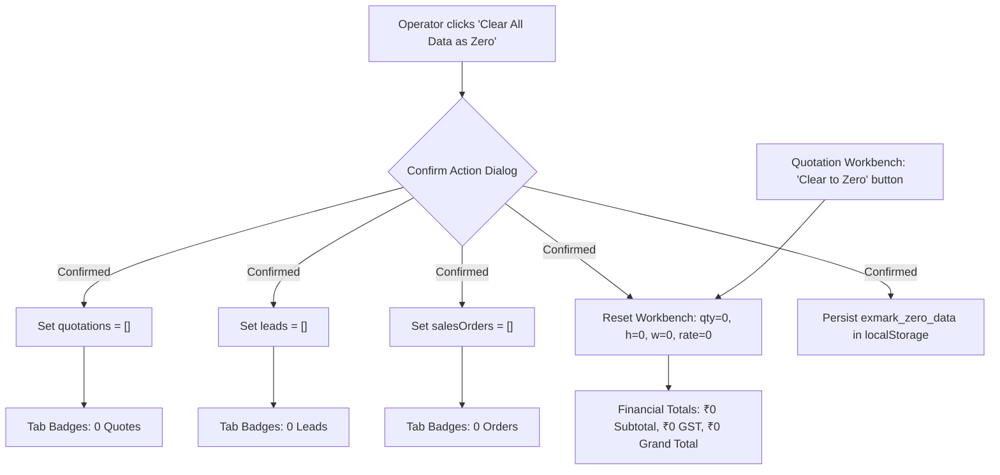

# Implementation Plan: Clear All Data as Zero (Fresh Factory Baseline)

Following the removal of demo banners, this plan establishes a clean **"Clear All Data as Zero"** capability across EXMARK ERP. It allows the factory operator to completely zero out the quotation builder (setting quantities, dimensions, rates, and totals to 0) as well as wipe existing sample transactional records (quotations, CRM leads, and active work orders to 0 records) for a pristine, real-world factory start.

---

## 1. Goal Description

Provide a 100% clean zero-baseline across the ERP:
1. **Quotation Creator Workbench Zeroing:**
   - Modify the quotation draft row and "Clear All" action so that clearing resets all row values to **zero** (`qty: 0`, `height: 0`, `widthTop: 0`, `widthBottom: 0`, `rate: 0`), resulting in instant **₹0 Subtotal, ₹0 GST, ₹0 Grand Total, and ₹0 Advance**.
   - Ensure the workbench allows empty/zero states without throwing `NaN` or display glitches.
   - Require `qty > 0` before allowing "Save & Generate Quote", showing an intuitive validation notice if the user attempts to generate an order with 0 doors.
2. **System-Wide / Hub-Wide "Clear All Data as Zero":**
   - Add a prominent **"Clear All Data as Zero"** action in the header bar of [`QuotationHub.tsx`](file:///c:/Users/NAZER%20KARUMBAN/EXMARK-Projects/exmark-erp/components/modules/quotations/QuotationHub.tsx) with a safety confirmation dialog.
   - Clears `quotations` $\to$ `[]` (0 records, ₹0 value).
   - Clears `leads` $\to$ `[]` (0 leads in pipeline).
   - Clears `salesOrders` $\to$ `[]` (0 active factory floor work orders).
   - Clears quotation item rows $\to$ single zero-initialized draft row.
   - Persists the zeroed state in `localStorage` (`exmark_data_state: "zero"`) so refreshing the page does not re-seed dummy records.
   - Provides a companion **"Restore Template Data"** option if the operator ever needs sample Kerala door specifications back.
3. **Professional Zero Empty States:**
   - Display sleek, branded zero-state placeholders in the Quotation Table, Kanban Pipeline, and Sales Orders view when counts are `0`.

---

## 2. User Review Required

> [!IMPORTANT]
> **Data Persistence Strategy:** When "Clear All Data as Zero" is triggered, the system will persist an `exmark_zero_data_active` flag in browser `localStorage`. When active, subsequent page reloads will open with 0 quotations, 0 leads, and 0 sales orders rather than re-populating initial sample arrays. A button to "Load Default Door Templates" will remain available.

> [!NOTE]
> **Master Door Models & Customers:** Door catalog models (e.g. Natural Teak Classic, Denwood WPC, etc.) will remain available in the dropdown selector so users can pick models when creating fresh orders, but all transactional quantities, measurements, prices, quotes, and orders will be cleared to zero.

---

## 3. Architecture & Data Flow



---

## 4. Proposed Changes

### Component: QuotationHub (`components/modules/quotations/QuotationHub.tsx`)

#### [MODIFY] `components/modules/quotations/QuotationHub.tsx`

1. **Zero State Draft Row Definition:**
   Create a standard zeroed row template:
   ```typescript
   const createZeroRow = (id = 1, modelId = ''): QuoteItemRow => ({
     id,
     modelId: modelId || doorModels[0]?.id || 'MOD-101',
     unit: 'inch',
     height: 0,
     heightFraction: '0',
     widthTop: 0,
     widthTopFraction: '0',
     widthBottom: 0,
     widthBottomFraction: '0',
     width: 0,
     widthFraction: '0',
     qty: 0,
     rate: 0,
   });
   ```

2. **Update `handleClearAll` to Zero:**
   ```typescript
   const handleClearAllToZero = () => {
     setQuoteItemRows([createZeroRow(1, doorModels[0]?.id)]);
     showToast('Workbench Cleared', 'All door quantities, dimensions, and rates set to 0.', 'info');
   };
   ```

3. **Implement Full Hub Data Zeroing (`handleClearAllDataAsZero`):**
   ```typescript
   const handleClearAllDataAsZero = () => {
     setQuotations([]);
     setLeads([]);
     setSalesOrders([]);
     setQuoteItemRows([createZeroRow(1, doorModels[0]?.id)]);
     if (typeof window !== 'undefined') {
       localStorage.setItem('exmark_data_zeroed', 'true');
       localStorage.removeItem('exmark_saved_quotations');
     }
     setIsZeroConfirmOpen(false);
     playBeep(480, 0.15);
     showToast('All Data Cleared to Zero', '0 quotations, 0 leads, 0 orders, ₹0 metrics.');
   };
   ```

4. **Add Safety Confirmation Modal (`isZeroConfirmOpen`):**
   - Clean dark-theme confirmation modal warning that all current active quotations, leads, and orders will be cleared to zero.
   - Includes "Yes, Clear All to Zero" (red button) and "Cancel" (neutral button).

5. **Empty State UI Enhancements:**
   - **Quotations Table:** When `quotations.length === 0`:
     ```tsx
     <tr>
       <td colSpan={7} className="p-8 text-center text-slate-500">
         <div className="flex flex-col items-center gap-2">
           <FileText className="w-8 h-8 text-slate-600" />
           <p className="font-semibold text-slate-300">0 Quotation Records</p>
           <p className="text-xs text-slate-500">All data cleared to zero. Configure door items above and tap "Save & Generate Quote" to record your first quote.</p>
         </div>
       </td>
     </tr>
     ```
   - **CRM Leads Kanban:** When `leads.length === 0`:
     - Show an empty column placeholder "No active leads (0 Records)".
   - **Sales Orders:** When `salesOrders.length === 0`:
     - Show "0 Active Factory Orders. Release quotes with 40% advance to initiate plant floor lines."

6. **Validation Guard on `handleSaveQuotation`:**
   ```typescript
   const totalDoors = quoteItemRows.reduce((acc, r) => acc + (Number(r.qty) || 0), 0);
   if (totalDoors <= 0) {
     playBeep(350, 0.15);
     showToast('Invalid Quantity', 'Please enter a door quantity greater than 0 before saving.', 'info');
     return;
   }
   ```

---

## 5. Verification Plan

### Automated Verification
1. Run TypeScript compiler to ensure 0 type errors:
   ```powershell
   node_modules\.bin\tsc.cmd --noEmit
   ```
2. Run HTTP server check to verify HTTP 200 OK:
   ```powershell
   node -e "const http = require('http'); http.get('http://localhost:3000', (res) => { console.log('STATUS:', res.statusCode); process.exit(0); });"
   ```

### Manual Verification
1. Open `http://localhost:3000` $\to$ Navigate to **Quotations** hub.
2. In the Quotation Creator Workbench:
   - Click **"Clear to Zero"**.
   - Verify all row fields become `0` (Height: 0, Width: 0, Qty: 0, Rate: 0).
   - Verify Subtotal displays `₹0`, GST displays `₹0`, Grand Total displays `₹0`.
3. In the Quotation Hub Top Bar:
   - Click **"Clear All Data as Zero"**.
   - Modal pops up asking for confirmation. Click "Yes, Clear All to Zero".
   - Verify tab badges change to `0 Quotes`, `0 Leads`, `0 Orders`.
   - Verify Quotations list, Leads board, and Sales Orders display clean empty zero states.
4. Attempt to save a quote with 0 quantity $\to$ verify warning toast prevents 0-door quote generation.
5. Enter a real door specification (`Height: 78`, `Width: 32`, `Qty: 10`, `Rate: 4200`) and click **Save & Generate Quote** $\to$ verify quote is created cleanly starting from zero baseline.
