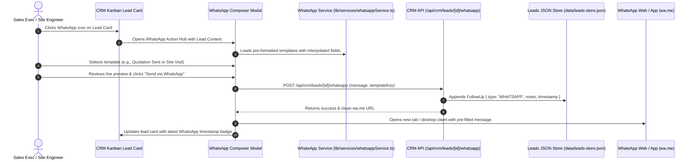

# Plan: WhatsApp Integration in CRM Module for Lead Management

## Goal Description
Integrate end-to-end **WhatsApp Lead Management** into the **EXMARK ERP CRM Module** (`components/modules/crm/LeadsPipeline.tsx` and `lib/services/crmService.ts`). 

This empowers plant sales executives, project coordinators, and site engineers to:
1. Instantly connect with architects, contractors, and builders across Kerala via direct WhatsApp Web and WhatsApp Desktop/Mobile deep-links.
2. Select from pre-configured, industry-tailored **WhatsApp Business Message Templates** (Inquiry Welcome & Brochure, Site Measurement Scheduling, GST Quotation Dispatch, 40% Advance Gatekeeper Notice, and Production/Dispatch updates).
3. Compose custom WhatsApp messages with real-time dynamic parameter substitution (`{contactPerson}`, `{title}`, `{doors}`, `{value}`, `{district}`, `{leadCode}`).
4. Automatically log every outgoing WhatsApp communication into the lead's persistent **CRM Follow-Up Timeline** (`leads-store.json`), creating an auditable communication trail.
5. Provide a quick-action WhatsApp button on every kanban lead card and inside the Lead Details / Notes modal.

---

## User Review Required

> [!IMPORTANT]
> **WhatsApp Deep-Linking Protocol:**
> The primary communication mechanism uses the universal WhatsApp Web / App protocol (`https://wa.me/<sanitized_phone>?text=<encoded_message>` and `whatsapp://send?phone=...`).
> - **Advantages:** Zero API subscription fees, zero rate limits, works natively on Windows Desktop Electron, browsers (Chrome/Edge), and Android Capacitor.
> - **Phone Number Sanitization:** Automatically normalizes Kerala phone formats (e.g. `+91 94470 12345`, `09895054321`, `97450 67890`) into clean E.164 format `919447012345` with standard Indian country code prefix `91`.

> [!NOTE]
> **Audit & Data Integrity:**
> Existing leads in `data/leads-store.json` and sales orders will be fully preserved. All 15 ERP audit modules in `scripts/master-erp-full-suite.ts` will continue to pass at 100%.

---

## Proposed Architecture & Workflow



---

## Proposed Changes

### Component 1: Core WhatsApp Service & Kerala Door Message Engine
Group: `lib/services`

#### [NEW] [`lib/services/whatsappService.ts`](file:///c:/Users/NAZER%20KARUMBAN/EXMARK-Projects/exmark-erp/lib/services/whatsappService.ts)
* **Phone Sanitizer:** Normalizes inputs like `+91 94470-12345`, `09447012345`, or `94470 12345` into `919447012345`.
* **Standard Industrial Templates:**
  1. `inquiry_welcome`: Welcome message with catalog links and product range (FRP & WPC doors, molded teak textures).
  2. `measurement_booking`: Confirms site tape measurement schedule with site engineer's name and visit date.
  3. `quote_submitted`: Informs client of GST Quotation number, total amount, 18% GST breakdown, and sample review.
  4. `advance_request`: Reminds client of the mandatory 40% advance deposit to release doors to the hydraulic press, including bank NEFT/RTGS details.
  5. `production_update`: Updates client when shutters enter hydraulic press bonding, PU polishing, or IS 14856:2000 QC pass.
  6. `dispatch_alert`: Dispatches gate pass details, vehicle KL registration, and driver contact.
  7. `custom`: Free-form message composer with dynamic tags.
* **URL Builder:** Formats `https://wa.me/{phone}?text={encoded}`.

---

### Component 2: WhatsApp CRM API Route
Group: `app/api/crm`

#### [NEW] [`app/api/crm/leads/[id]/whatsapp/route.ts`](file:///c:/Users/NAZER%20KARUMBAN/EXMARK-Projects/exmark-erp/app/api/crm/leads/[id]/whatsapp/route.ts)
* **POST Handler:**
  * Validates `leadId`, `phone`, `templateKey`, and `messageText`.
  * Logs a new `FollowUp` entry into `crmService.addFollowUp(leadId, { type: 'WHATSAPP', notes: `[WhatsApp: ${templateTitle}] ${messageText}`, completedAt: new Date().toISOString() })`.
  * Returns `{ success: true, whatsappUrl, followUp }`.
* **GET Handler:**
  * Returns available WhatsApp templates populated with that lead's dynamic data and historical WhatsApp logs for that lead.

---

### Component 3: CRM UI & Interactive WhatsApp Composer
Group: `components/modules/crm`

#### [NEW] [`components/modules/crm/WhatsAppLeadModal.tsx`](file:///c:/Users/NAZER%20KARUMBAN/EXMARK-Projects/exmark-erp/components/modules/crm/WhatsAppLeadModal.tsx)
* Responsive modal / slide-over drawer with:
  * Lead overview header (Project name, Client, District, sanitized phone with Kerala badge).
  * Quick-select template pills (`Initial Welcome`, `Site Measurement`, `GST Quote`, `40% Advance Gate`, `Production`, `Custom`).
  * Live editable message box with character count and dynamic tag buttons (`+ Project`, `+ Client`, `+ Doors`, `+ Value`).
  * Instant Live Preview Card styled like a WhatsApp chat bubble with timestamp.
  * Checkbox: `[x] Automatically record this in CRM Follow-up Timeline`.
  * Primary Action: **"Open in WhatsApp (Web / Desktop)"** in signature WhatsApp emerald green (`#25D366` / `bg-emerald-600`).
  * History list of previous WhatsApp messages sent to this lead.

#### [MODIFY] [`components/modules/crm/LeadsPipeline.tsx`](file:///c:/Users/NAZER%20KARUMBAN/EXMARK-Projects/exmark-erp/components/modules/crm/LeadsPipeline.tsx)
* Import `WhatsAppLeadModal` and WhatsApp icon (`MessageSquare` / WhatsApp SVG).
* Add state `[selectedLeadForWhatsApp, setSelectedLeadForWhatsApp]`.
* **Lead Card Quick Action:**
  * Add a green WhatsApp icon button next to the client's phone number on every kanban card:
    ```tsx
    <button
      type="button"
      onClick={(e) => {
        e.stopPropagation();
        openWhatsAppModal(lead);
      }}
      className="p-1 rounded-md text-emerald-400 bg-emerald-500/10 hover:bg-emerald-500/20 border border-emerald-500/20"
      title={`Chat with ${lead.contactPerson || lead.client} on WhatsApp`}
    >
      <MessageSquare className="w-3 h-3 text-emerald-400" />
    </button>
    ```
  * In the card action bar, add a dedicated `WhatsApp` button alongside `Notes` and `Advance`.
  * Display a small WhatsApp indicator tag when the lead has previous WhatsApp follow-ups.

---

### Component 4: Full Suite Audit & Regression Testing
Group: `scripts`

#### [MODIFY] [`scripts/master-erp-full-suite.ts`](file:///c:/Users/NAZER%20KARUMBAN/EXMARK-Projects/exmark-erp/scripts/master-erp-full-suite.ts)
* Add assertions under `[Module 1] CRM & Leads Pipeline`:
  * `✓ [M1: CRM] WhatsApp Service module exists with phone sanitizer`
  * `✓ [M1: CRM] Sanitizes Kerala mobile numbers (+91, 0, spaces) to E.164 91...`
  * `✓ [M1: CRM] WhatsApp Kerala door business templates registered (Inquiry, Measurement, Quote, 40% Advance)`
  * `✓ [M1: CRM] WhatsApp API route handles automated Follow-Up timeline logging`
  * `✓ [M1: CRM] WhatsAppLeadModal component exists with live chat bubble preview`

---

## Verification Plan

### Automated Verification
1. **TypeScript compilation check:**
   ```powershell
   npx.cmd tsc --noEmit
   ```
   *Expected:* Exit code 0, 0 type errors.

2. **Full Master ERP Suite Audit:**
   ```powershell
   npm.cmd run erp:full-audit
   ```
   *Expected:* 100% assertions passing (all 15 modules).

3. **WhatsApp Service Unit Verification Script:**
   * Run a verification script testing phone normalization, template interpolation, and wa.me deep-link URL encoding.

### Manual Verification
1. Navigate to **CRM & Leads Pipeline** (`http://localhost:3000`).
2. Click the green WhatsApp button on any Lead Card (e.g. `Skyline Sea View Luxury Apartments`).
3. Confirm the **WhatsApp Lead Management Hub** modal opens with client data pre-filled.
4. Switch between templates (`Quotation Submitted`, `Site Measurement`, `40% Advance Gatekeeper`).
5. Confirm live preview bubble reflects changes and values accurately.
6. Click **"Send via WhatsApp"** — verify that:
   - A new browser tab or WhatsApp window launches with the pre-filled message and target number.
   - The message is automatically recorded in the lead's follow-up notes/timeline.
   - A success toast appears in the CRM interface.
