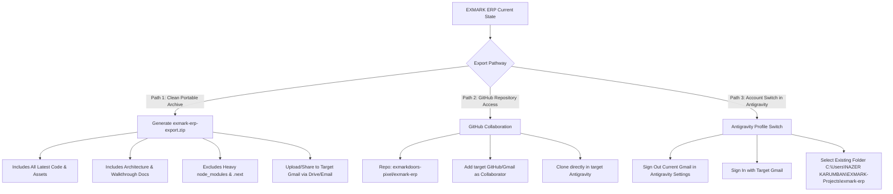

# Implementation Plan: Export EXMARK ERP to Another Gmail / Antigravity Account

Comprehensive plan to transfer, export, and configure the **EXMARK ERP** project, codebase, documentation artifacts, and environment so it can be seamlessly accessed and operated from another Gmail account and Antigravity instance.

---

## User Review Required

> [!IMPORTANT]
> Depending on your exact goal, there are two primary export pathways:
> 1. **Same Computer, Different Gmail Account in Antigravity**: Switch the logged-in Google account in the Antigravity desktop application and re-open the existing workspace folder (`C:\Users\NAZER KARUMBAN\EXMARK-Projects\exmark-erp`).
> 2. **Different Computer / Cloud / External Account**: Export a clean portable package (Codebase ZIP + Environment Guide + Project Documentation Artifacts) or grant repository access on GitHub (`https://github.com/exmarkdoors-pixel/exmark-erp.git`).

---

## Proposed Export Strategy

---

## Proposed Execution Steps

### 1. Create a Clean Portable Export Bundle (`exmark-erp-export.zip`)
- Create an automated export script that packages:
  - All application code (Next.js 16 app, React components, Tailwind CSS, Electron main/preload).
  - All database schemas (Prisma schema, migrations, SQLite/mock stores).
  - All newly added modules (WhatsApp CRM Lead Modal, 12L & Thermal Sticker Engine, Production Floor).
  - Environment templates (`.env.example`, `.env.development`).
  - Readme and quick-start instructions for opening in Antigravity under the new Gmail account.
- Exclude `node_modules/`, `.next/`, `dist/`, and large build caches to ensure the zip file is compact (typically under 15-25 MB) and easy to send via Gmail or Google Drive.

### 2. Export Antigravity Artifacts & Context
- Copy key architectural plan documents, verification reports, and walkthroughs from the brain directory into a dedicated `docs/antigravity-artifacts/` folder within the exported package.
- This ensures the agent running on the target Gmail account has immediate access to historical context, specifications, and design rationale.

### 3. Step-by-Step Setup Guide for Target Gmail Account
Provide clear, copy-pasteable instructions for the recipient Gmail account:
1. **In Antigravity App**:
   - Open Antigravity with the target Gmail account.
   - Click **Projects** > **Open Folder** (or clone the repository).
2. **Dependencies & Environment**:
   - Run `npm install`
   - Copy `.env.example` to `.env` (or transfer `.env`)
   - Run `npx prisma generate`
   - Run `npm run dev`
3. **Verification**:
   - Verify `http://localhost:3000` loads the full ERP with CRM, WhatsApp integration, and Production Suite.

---

## Verification Plan

### Automated Verification
- Verify zip archive creation without corrupted paths or oversized node_modules.
- Test unzipping into a clean temporary directory and verifying `npm run build` or `npx tsc --noEmit`.

### Manual Verification
- Confirm target file location and size for easy sharing to the designated Gmail address.
