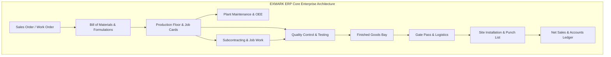

# Implementation Plan: Benchmark & Implement All Standard Manufacturing Company ERP Modules

Benchmarking **EXMARK ERP** against global and Indian manufacturing ERP industry leaders (**SAP S/4HANA Manufacturing, Odoo Enterprise Manufacturing, Oracle NetSuite Discrete Manufacturing, Microsoft Dynamics 365 Supply Chain, and TallyPrime Manufacturing**) to establish an end-to-end, world-class enterprise manufacturing architecture for polymer doors, frames, and architectural products.

---

## 1. Goal Description

A complete discrete and process manufacturing ERP requires tight coupling between:
1. **Commercial & Engineering Master Data**: Multi-level Bill of Materials (BOM), resin-catalyst formulations, routing sequences, and standard costing.
2. **Quality Management (QM)**: Inward inspection of raw chemicals (resin, roving, pigment), in-process compression molding quality checks, and final pre-dispatch squareness & water tightness audits.
3. **Plant & Asset Maintenance (PM / EAM)**: Hydraulic press calibration, heated platen maintenance, CNC router spindle health, and Overall Equipment Effectiveness (OEE).
4. **Subcontracting & Job Work**: External specialized processes (decorative glass etching, CNC brass inlays, PU lacquering) under GST Section 143 / Delivery Challan Rule 45.
5. **Site Installation & Field Service (FSM)**: Field carpenter dispatch, site frame rebate verification, punch list snagging, and customer handover sign-off.
6. **Logistics & Gate Pass Control**: Returnable (RGP) and Non-Returnable (NRGP) gate passes, Kerala vehicle loading slips, and e-Way bill coordination.

This plan details the architecture, data models, UI interfaces, navigation structure, and verification suite to bring these missing benchmarked manufacturing modules into EXMARK ERP without breaking any existing features.

---

## 2. ERP Industry Benchmark & Gap Matrix

| ERP Functional Domain | SAP S/4HANA Equivalent | Odoo Enterprise Equivalent | NetSuite Equivalent | EXMARK ERP Current Status | Proposed Evolution |
| :--- | :--- | :--- | :--- | :--- | :--- |
| **BOM & Formulation** | `PP-BD` (Bills of Material) | `mrp.bom` (PLM & By-products) | Assemblies & Work Orders | Hardcoded presets | **Dedicated BOM & Recipe Hub (`'bom'`)**: Multi-layer door recipes, resin/catalyst ratios, scrap factor, unit standard cost |
| **Quality Control & QA** | `QM` (Quality Management) | `quality.check` / Alerts | NetSuite Quality Management | Partial modal in production | **Dedicated Quality Hub (`'quality'`)**: IQC (Inward), IPQC (In-Process), FQC (Pre-Dispatch), NCR & Defect RCA |
| **Plant Maintenance & OEE** | `PM` (Plant Maintenance) | `maintenance.equipment` | Fixed Assets & Maintenance | None (Basic press queue) | **Plant Maintenance Hub (`'maintenance'`)**: Machine registry, preventive schedules, breakdown tickets, OEE tracking |
| **Subcontracting / Job Work** | `MM-SUB` (Subcontracting) | Subcontracting Work Orders | Outsourced Manufacturing | None | **Subcontracting Hub (`'job-work'`)**: GST Sec 143 Challan, external vendor tracking, return ageing |
| **Site Installation & Field Service** | `CS` (Customer Service) | Field Service Management | Field Service Suite | Embedded in Dispatch | **Site Fitting & Punch List Hub (`'installation'`)**: Carpenter dispatch, site snag list, client OTP sign-off |
| **Gate Pass & Vehicle Loading** | `LE-TRA` / Security Gate | Fleet & Delivery Slips | Warehouse Gate Operations | Partial vehicle field | **Gate Pass & Logistics Hub (`'gate-pass'`)**: Inward/Outward RGP/NRGP, security sign-off, driver challans |

---

## 3. User Review Required

> [!IMPORTANT]
> **Sidebar Navigation Structure & Module Grouping**
> Adding 6 new modules would expand total tabs from 16 to 22. To prevent sidebar clutter, we propose organizing the navigation into clean collapsible enterprise categories:
> 1. **Commercial & Sales** (Dashboard, Customers, CRM, Quotations, Measurements, Sales Orders, Sales & Returns)
> 2. **Factory & Engineering** (Production Floor, **BOM & Recipes**, **Quality Control & QA**, **Plant Maintenance & OEE**, **Subcontracting / Job Work**)
> 3. **Supply Chain & Logistics** (Raw Materials Inventory, Purchases & Vendors, **Gate Pass & Logistics**, Dispatch & Fleet)
> 4. **Field Service & Operations** (**Site Installation & Punch List**, Marketing Display Racks, Staff & Technicians)
> 5. **Finance & Governance** (Accounts & GST, Executive Analytics, Enterprise Settings)

> [!NOTE]
> **Data Persistence & Zero-Regression Commitment**
> All newly introduced modules will follow our established reactive patterns:
> - Full standalone UI views with dark-theme consistency (`#070D1E`, `#0B132B`).
> - Role-based access permission mapping in [`lib/auth/roles.ts`](file:///c:/Users/NAZER%20KARUMBAN/EXMARK-Projects/exmark-erp/lib/auth/roles.ts).
> - Integration with the Corporate Modules directory in [`CorporateModulesHub.tsx`](file:///c:/Users/NAZER%20KARUMBAN/EXMARK-Projects/exmark-erp/components/dashboard/CorporateModulesHub.tsx).
> - Zero breaking changes to existing quotations, measurements, production, sales, and accounts workflows.

---

## 4. Open Questions

> [!QUESTION]
> 1. **Rollout Phasing Strategy:**
>    - **Option A (All Modules Unified - Recommended):** Implement all 6 modules with complete enterprise data models, interactive tables, create/edit modals, and KPI banners in one coordinated release.
>    - **Option B (Staged Rollout):** Phase 1: BOM & Quality Control; Phase 2: Plant Maintenance & Subcontracting; Phase 3: Field Installation & Gate Passes.
> 2. **Kerala Subcontracting Tax Preference:**
>    - Should external job work default to **GST Section 143 Job Work Challan** (tax-exempt job work with 1-year return period) or regular vendor tax billing? (We recommend Section 143 as standard practice in door manufacturing).

---

## 5. Proposed Changes & Technical Architecture



### Module 1: Bill of Materials (BOM) & Product Recipe Engineering (`'bom'`)
- **File:** `components/modules/engineering/BomAndRecipeHub.tsx`
- **Data Model:**
  - `DoorRecipe`: Model ID, Door Category (FRP, WPC, Hybrid), Nominal Size, Resin Mix (kg), Woven Roving Layers, PU Foam Core Density, Internal Timber/WPC Frame Stile/Rail specs, Hardware Pack.
  - `BomComponent`: Material Item ID, Quantity, UOM (`kg`, `sq.m`, `cu.ft`, `running ft`, `pcs`), Wastage/Scrap Allowance (%), Standard Cost per Unit.
  - Cost Rollup Engine: Auto-computes **Standard Raw Material Cost + Machine Absorption Overhead + Direct Labor = Base Manufacturing Cost**.

### Module 2: Quality Control & Testing (QA/QC & Lab Inspection) (`'quality'`)
- **File:** `components/modules/quality/QualityControlHub.tsx`
- **Sub-Tabs:**
  1. **Inward Material QC (IQC):** Chemical lot inspection (Resin Viscosity, Catalyst reactivity, Gelcoat shade check, Fiberglass moisture).
  2. **In-Process QC (IPQC):** Press temperature ($120^\circ-140^\circ\text{C}$), hydraulic pressure (150-200 Bar), thickness profile ($\pm 0.5\text{ mm}$), bubble inspection.
  3. **Pre-Dispatch QC (FQC / PQC):** Diagonal squareness tolerance ($\le 1.0\text{ mm}$), water submersion seal test, hinge router alignment, barcoded QC Pass stamp.
  4. **NCR & Rejection RCA:** Non-conformance log, scrap write-offs, and root-cause categories.

### Module 3: Plant Maintenance & OEE Tracking (`'maintenance'`)
- **File:** `components/modules/maintenance/PlantMaintenanceHub.tsx`
- **Features:**
  - Machine Master: 8 Hydraulic Hot Presses, 3 CNC 3-Axis Routers, 2 Resin Mixing Agitators, Heavy Air Compressors.
  - Schedules: Daily pre-start checklists, weekly hydraulic seal checks, monthly oil changes, 6-month thermal platen calibration.
  - Real-time OEE Calculation: $\text{OEE} = \text{Availability} \times \text{Performance} \times \text{Quality}$.
  - Breakdown Tickets: Log unplanned downtime, mechanic assignment, MTTR & MTBF metrics.

### Module 4: Subcontracting & Job Work (GST Sec 143) (`'job-work'`)
- **File:** `components/modules/jobwork/SubcontractingHub.tsx`
- **Features:**
  - Outward Job Work Challans (Rule 45): Track doors dispatched for decorative glass embedding, CNC 3D brass inlaying, or vacuum membrane pressing.
  - Statutory 1-Year Return Clock (GST Section 143) with countdown warnings.
  - Inward Inspection & Vendor Job Charges reconciliation.

### Module 5: Site Installation & Field Service Punch List (`'installation'`)
- **File:** `components/modules/fieldservice/SiteInstallationHub.tsx`
- **Features:**
  - Installation Scheduler: Assign lead carpenter & fitting helper teams to Kerala job sites.
  - Pre-Installation Masonry Check: Verify rebate depth and wall verticality against the Site Measurement Book.
  - Digital Punch List (Snagging): Track lock strike plate fit, door clearance gap, bottom sweep seal.
  - Final Customer Handover: Digital signature capture & customer OTP sign-off triggering 15-Year Material Warranty activation.

### Module 6: Gate Pass & Vehicle Logistics (`'gate-pass'`)
- **File:** `components/modules/logistics/GatePassHub.tsx`
- **Features:**
  - Inward Gate Pass: Chemical tankers, raw material lorries, returned doors for rework.
  - Outward Returnable Gate Pass (RGP): Reusable steel pallets, sample doors for architects, tools sent for sharpening.
  - Outward Non-Returnable Gate Pass (NRGP): Customer door dispatches linked to Tax Invoices and Kerala e-Way Bills.
  - Security Guardhouse log with driver phone, vehicle registration (KL-xx), and exit timestamps.

---

## 6. Implementation Steps

1. **Update Types & Roles:**
   - Extend `NavigationTab` in [`types/erp.ts`](file:///c:/Users/NAZER%20KARUMBAN/EXMARK-Projects/exmark-erp/types/erp.ts) with `'bom'`, `'quality'`, `'maintenance'`, `'job-work'`, `'installation'`, `'gate-pass'`.
   - Update role permissions in [`lib/auth/roles.ts`](file:///c:/Users/NAZER%20KARUMBAN/EXMARK-Projects/exmark-erp/lib/auth/roles.ts) to grant appropriate access.
2. **Update Navigation & Hubs:**
   - Add new items to [`components/layout/Sidebar.tsx`](file:///c:/Users/NAZER%20KARUMBAN/EXMARK-Projects/exmark-erp/components/layout/Sidebar.tsx) under categorized headers.
   - Register module cards in [`components/dashboard/CorporateModulesHub.tsx`](file:///c:/Users/NAZER%20KARUMBAN/EXMARK-Projects/exmark-erp/components/dashboard/CorporateModulesHub.tsx).
3. **Build Core Module Components:**
   - Create `BomAndRecipeHub.tsx`
   - Create `QualityControlHub.tsx`
   - Create `PlantMaintenanceHub.tsx`
   - Create `SubcontractingHub.tsx`
   - Create `SiteInstallationHub.tsx`
   - Create `GatePassHub.tsx`
4. **Wire Views & Dashboard Routing:**
   - Export view wrappers in [`components/modules/ModuleViews.tsx`](file:///c:/Users/NAZER%20KARUMBAN/EXMARK-Projects/exmark-erp/components/modules/ModuleViews.tsx).
   - Render views in [`app/page.tsx`](file:///c:/Users/NAZER%20KARUMBAN/EXMARK-Projects/exmark-erp/app/page.tsx).
5. **Develop Automated Test Suite:**
   - Create `scripts/test-leading-manufacturing-erp-modules.js` to validate standard costing, QC pass rates, OEE formulas, and Job Work statutory compliance.

---

## 7. Verification Plan

### Automated Tests
- Execute test script:
  ```powershell
  node scripts/test-leading-manufacturing-erp-modules.js
  ```
- Run full TypeScript compiler verification:
  ```powershell
  node_modules\.bin\tsc.cmd --noEmit
  ```
- Verify HTTP status of Next.js dev server:
  ```powershell
  node -e "const http = require('http'); http.get('http://localhost:3000', (res) => { console.log('STATUS:', res.statusCode); process.exit(0); });"
  ```

### Manual Verification
- Navigate to each new tab via the Sidebar and Corporate Modules Hub.
- Test creating a Door Recipe and check cost roll-up.
- Test logging an In-Process QC check and verifying the pass/fail stamp.
- Test generating an Outward Job Work Challan under GST Section 143.
- Test recording an Installation Punch List snag item and capturing handover OTP.
- Test issuing a Factory Non-Returnable Gate Pass (NRGP) for vehicle dispatch.
