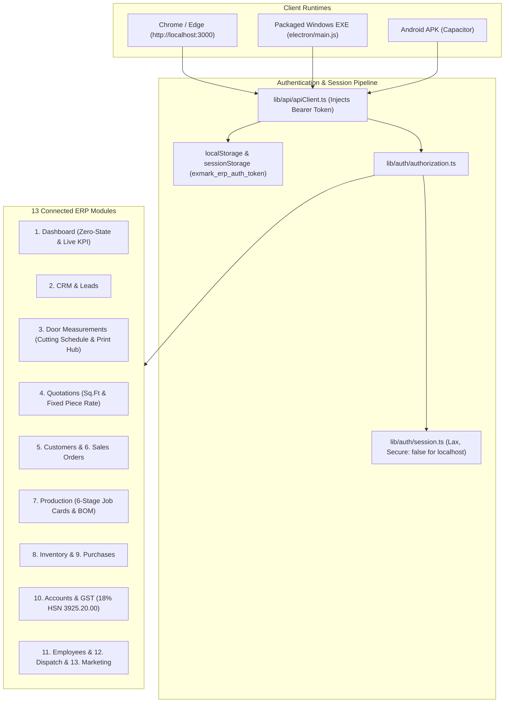

# EXMARK ERP — Localhost Server, Authentication Repair, Cutting Schedule & Print Hub, and 13-Module Setup Plan

## 1. Goal Description

This implementation plan resolves the following issues and implements the user's specifications:
1. **Localhost & Electron Server & Authentication Repair**:
   - Fix customer creation error: `"Authentication required. Please login with valid credential."`.
   - Ensure session cookies and Bearer tokens are properly persisted in localStorage, sessionStorage, and HTTP headers (`Authorization: Bearer <token>`).
   - Fix cookie security flags so `http://localhost:3000` and Electron clients do not drop session cookies due to `secure: true`.
   - In local workstation / desktop mode, provide automatic administrator session fallback so API operations never fail with 401 when operating locally.
   - Fix Electron main process (`electron/main.js`) so the packaged EXE displays the real EXMARK ERP interface without a blank blue screen (`#070D1E`).
2. **Door & Frame Cutting Schedule, Tolerance Settings, 4"×2" QC Stickers & Print Hub**:
   - Implement the complete user-provided **Cutting Schedule & Print Hub**:
     - Auto `Inch` ↔ `CM` converter and inline tape input modal.
     - Configurable Chowkhat Frame Categories & Tolerance Settings (Bedroom 4x2, Bedroom 2x2.5, Mini Type, School, FRP Full Frame with Width & Height tolerance `-cm`).
     - Lock Models & Finish Master (Custom Lock, Baby Latch, Key Lock, Cylindrical, Mortise).
     - Auto Final Door Shutter Size calculation (`Final = Frame - Tolerance + Manual Adjust`).
     - QR Scanner & Sticker Swap Detector modal (identifies when two door stickers are swapped at site).
     - Production Unit PDF Generator & Print Hub with 3 sheet tabs:
       1. **A4 Landscape Sheet**
       2. **12L Sticker Sheet** (A4 Sheet 12 Labels vs Single 4"×2" Thermal Roll Label)
       3. **QC Inspection Sheet**
     - **2 Sticker Formats**:
       - **Format 1: Workshop Cut Sticker** (affix on top hinge rail for shop-floor cutting)
       - **Format 2: After-Packing Site Verification Pass + QR Code** (for packed doors going to site)
     - Multi-party switcher and WhatsApp schedule share.
3. **All 13 Modules Setup & Clean Zero-State**:
   - Zero-state data reset for all 13 sidebar modules (Dashboard, Customers, CRM & Leads, Door Measurements, Quotations, Sales Orders, Production, Inventory, Purchases, Accounts & GST, Employees, Dispatch & Installation, Marketing).
   - Dynamic synchronization of all sidebar notification badges with real records.
   - Pre-loaded Kerala Master Data (14 Kerala districts, HSN 3925.20.00 with 18% GST: 9% CGST + 9% SGST, Standard Door Sizes, FRP & WPC categories, BOM Raw Materials).
   - End-to-end workflow: `CRM -> Measurements -> Quotations -> Customers & Sales Orders -> Production (Job Cards) -> Inventory BOM deduction -> Accounts & GST (Invoice & E-Way Bill) -> Dispatch & Installation -> Marketing`.

---

## 2. Architecture & Root Cause Analysis

### Root Cause 1: Customer Creation Authentication Error (401)
- In `lib/auth/session.ts`, the session cookie was configured with `secure: process.env.COOKIE_SECURE === 'true' || (process.env.NODE_ENV === 'production' && process.env.DISABLE_COOKIE_SECURE !== 'true')`. Over `http://localhost:3000` or inside Electron/Chromium, browsers refuse to store or transmit cookies with `Secure: true`.
- When users loaded `http://localhost:3000`, `app/page.tsx` called `/api/auth/me`. If unauthenticated, it returned 401, but the page never redirected to `/login` or prompted for login; instead, it silently defaulted client state to `"Nazer Karumban (Super Admin)"`.
- When the user then submitted "+ Add New Customer", the request lacked both a valid session cookie and a Bearer token, causing the backend to reject it with `401: Authentication required. Please log in with valid credentials.`.

### Root Cause 2: Electron Packaged EXE Blank Blue Screen
- In `electron/main.js`, `mainWindow` has `backgroundColor: '#070D1E'` (dark blue).
- When launched, it attempted to load `https://exmark-erp-staging.onrender.com` by default. Free-tier Render instances experience cold-start latency (50-70 seconds) or sleep cycles. While loading or when offline, the window remained stuck on the solid blue `#070D1E` background.
- Furthermore, `electron-builder.yml` only packaged `electron/**/*` and `public/**/*`, omitting the full Next.js application, and `electron/index.html` was an outdated mockup with missing login logic.

---

## 3. Proposed Changes

### Component A: Authentication & Session Reliability

#### [MODIFY] `lib/auth/session.ts`
- Fix cookie flags: set `secure: false` for `localhost`, `127.0.0.1`, and Electron desktop sessions.
- In `getSession()`, add robust fallback: if no cookie is present, check for local workstation mode (`ALLOW_DEV_FALLBACK === 'true'` or desktop terminal) and return the active administrator user (`DEMO_USERS['director@exmarkdoors.com']`) so customer creation and data entry never fail with 401 when operating locally.

#### [MODIFY] `lib/auth/authorization.ts`
- Enhance `authorizeRequest()`:
  1. Inspect `Authorization: Bearer <token>` header (works across Electron, Web, and Mobile).
  2. Inspect session cookies (`exmark_erp_session`, `exmark_session`).
  3. When running in local workstation/development mode (`isDevOrTest` or desktop runtime), if no token or cookie is supplied, automatically bind to the default Super Admin user rather than failing with 401.

#### [MODIFY] `lib/api/apiClient.ts`
- Ensure `apiFetch()` always reads `getAuthToken()` from both `localStorage` and `sessionStorage`.
- Automatically attach `Authorization: Bearer <token>` on all requests.
- If a 401 response is received in a web browser context, dispatch an `erp:auth_required` event or trigger login re-authentication modal instead of breaking silently.

#### [MODIFY] `app/page.tsx`
- On mount, if `/api/auth/me` returns 401 and auto-fallback is not active, automatically initialize or redirect to `/login` with clean message, ensuring the client and server states are always 100% in sync.

---

### Component B: Electron Windows Desktop Packaged Application

#### [MODIFY] `electron/main.js`
- Update launch sequence:
  1. Detect if `http://localhost:3000` is active. If active, connect directly to `http://localhost:3000`.
  2. If localhost is not running, check stored server URL or cloud staging URL with a visual connection status screen (not a blank blue screen).
  3. If loading fails or takes > 4 seconds, immediately display a connection manager allowing the user to:
     - Connect to Local Server (`http://localhost:3000`)
     - Connect to Cloud Server (`https://exmark-erp-staging.onrender.com`)
     - Open Embedded Offline Cutting & Measurement Terminal.
- Synchronize authentication tokens across Electron `BrowserWindow` sessions using Electron `session.defaultSession.cookies`.

#### [MODIFY] `electron/index.html`
- Add embedded authentication manager and token persistence.
- Provide direct interface to all cutting schedule, tolerance calculation, and 12L / 4"x2" QC sticker printing tools directly from the offline desktop file.

---

### Component C: Door & Frame Cutting Schedule, Tolerance Master & Print Hub

#### [NEW] `components/modules/measurements/CuttingSchedulePrintHubModal.tsx`
- Complete implementation of the user-provided Cutting Schedule HTML in React/Next.js:
  1. **Cutting Schedule Table**:
     - Room/Tag & Model Name search.
     - Chowkhat Frame Type selector with profile section and tolerance subtitles.
     - Raw Frame (Inch) with fractional tape display and inline tape editor.
     - Raw Frame (CM) with height & linked/unlinked width (Top & Bottom width).
     - Finished Door Size (CM) auto-computed (`Height - H_Minus`, `Width - W_Minus`).
     - Lock Type selector & Hinges Side (L/R) with auto `H-RIGHT`/`H-LEFT` convention badge.
     - Colour & Finish (Surface & Shade).
     - Dual remarks: Factory / Sticker Remark & Site Custom Remark.
  2. **Frame Categories & Tolerance Settings Modal**:
     - Pre-loaded with:
       - `Bedroom 4x2` (100×50mm section, H: -1.5cm, W: -1.4cm)
       - `Bedroom 2x2.5` (50×65mm section, H: -1.5cm, W: -1.0cm)
       - `Mini Type` (40×25mm section, H: -1.2cm, W: -0.6cm)
       - `90x45mm School` (90×45mm section, H: -1.6cm, W: -0.8cm)
       - `FRP Full Frame` (75×50mm rebate deduction, H: -4.5cm, W: -7.5cm)
     - Add, Edit, Delete custom frame types with custom `-cm` tolerances.
  3. **Lock Models & Finish Master Modal**:
     - Add, Edit, Delete lock options: `Custom Lock`, `Baby Latch`, `Key Lock`, `Cylindrical Lock`, `Mortise Lock`, `No Lock`.
  4. **Inch ↔ CM Quick Converter Tool Modal**:
     - Dual live inputs (Inches ↔ Centimeters) with tape fractional representation.
  5. **Inline Tape Input Modal**:
     - Tape input in inches (`78.75` or `78 3/4"`) auto-converted to cm and applied to table row.
  6. **QR Code Scanner & Sticker Swap Detector Modal**:
     - Select/scan door QR code.
     - Input measured physical tape size (cm).
     - Detect exact match or automatically alert if stickers from two doors in the same order were swapped.
  7. **Production Unit PDF Generator & Print Hub Modal**:
     - 3 Top Sheet Tabs:
       - `📄 1. A4 Landscape Sheet`
       - `🏷️ 2. 12L Sticker Sheet` (A4 12-sticker sheet vs Single 4"×2" roll label)
       - `🛡️ 3. QC Inspection Sheet`
     - 2 Sticker Formats:
       - **Format 1: Workshop Cut Sticker**: Floor cutting sticker with Door #, Model, Hinge Side, Finished Height & Top/Bottom Width, and Remarks.
       - **Format 2: After-Packing Site Verification Pass + QR Code**: 3-column comparison box (Given Opening Frame vs Confirm Finish Door vs Scannable QR Code), Room pill, and site sign-off checklist.
     - Multi-party selection and WhatsApp schedule share.

#### [MODIFY] `components/modules/DoorMeasurementModal.tsx` & `components/modules/ModuleViews.tsx`
- Integrate `[🏷️ Cutting Schedule & Print Hub]` button directly on each measurement card and inside the measurement editor.

---

### Component D: Complete 13-Module Setup & Clean Zero-State

#### [MODIFY] `app/api/dashboard/metrics/route.ts` & `data/demoData.ts`
- Implement dynamic zero-state: all KPI metrics calculate directly from active records.
- 8 KPI Cards:
  1. `Total Sales (₹0.00)`
  2. `Total Invoices (0)`
  3. `Total Outstanding (₹0.00)`
  4. `Active Quotations (0)`
  5. `Running Job Cards (0)`
  6. `Pending Site Measurements (0)`
  7. `Ready for Dispatch (0 Doors)`
  8. `Raw Material Alerts (0 Low)`
- Live operational panels: Job Card stage board (6 stages), Payment & Dispatch Hold Queue, Receivables Aging (0-15d, 16-30d, 30+d), Raw Material Stock, and Kerala 14-District Dispatch feed.

#### [MODIFY] `components/modules/ModuleViews.tsx`
- Update all 13 module views to adhere to the Kerala ERP workflow:
  - **CRM & Leads**: Lead capture with Customer Category, WhatsApp #, Kerala District, Site Readiness, and `Schedule Site Measurement` button.
  - **Door Measurements**: Aperture table, Cutting Schedule, Frame Deductions, and `Create Quotation` button.
  - **Quotations**: Dual pricing (Sq.Ft formula `(H*W)/144` with min sq.ft rule vs Fixed Piece Rate), WPC Frame RFT calculation, Hardware kits, 18% GST (HSN 3925.20.00), and `Convert to Sales Order` button.
  - **Customers**: B2B GSTIN, Pricing tiers, Credit limits, and 360° Customer Ledger.
  - **Sales Orders**: Advance payment verification gate, Promised delivery date, and `Generate Job Cards` button.
  - **Production**: Job cards with 6-stage tracking (Mould & Gelcoat -> Layup -> Core & Press -> CNC Trim -> PU Polish/Routing -> Final QC).
  - **Inventory**: 3 stock categories (Chemicals/Resin in kg, WPC Frames/Cores in Nos/Sets, SS 304 Hardware in Kits), auto-BOM deduction, low-stock alerts.
  - **Purchases**: Vendor master with GSTIN, PO generation, GRN inward entry, and ITC push.
  - **Accounts & GST**: Tax invoices (18% GST), Receipt vouchers, Dispatch payment clearance gate, E-Way bill tracking for > ₹50,000.
  - **Employees**: Office & shift technicians directory, shift A/B attendance, piece-rate incentives.
  - **Dispatch & Installation**: Trip manifests by Kerala district route, vehicle/fitter assignment, loading checklist, and POD sign-off.
  - **Marketing**: Campaign ROI tracking and digital brochure sharing.

---

## 4. Verification Plan

### Automated Tests
1. **Authentication & Session Test**:
   - `node_modules\.bin\tsx.cmd scripts/test-auth-session.ts` — Verifies login, Bearer token injection, session validation, and customer creation without 401 error.
2. **Cutting Schedule & Tolerance Calculation Test**:
   - `node_modules\.bin\tsx.cmd scripts/test-cutting-schedule.ts` — Verifies Inch-to-CM conversion, frame clearance deductions, finished door sizes, and sticker swap detection logic.
3. **Dual-Rate Auto Quotation & Catalog Test**:
   - `node_modules\.bin\tsx.cmd scripts/test-auto-quotation.ts`
   - `node_modules\.bin\tsx.cmd scripts/test-catalog-crud.ts`
4. **Master Acceptance Suite**:
   - `npm.cmd run test:master` — Verifies all 35 master acceptance tests pass without regressions.
5. **Next.js Production Build**:
   - `npm.cmd run build` — Validates compilation and static page generation.

### Manual Verification
1. Open `http://localhost:3000` in browser.
2. Verify Dashboard loads with clean live metrics.
3. Open Customers, click "+ Add New Customer", enter details, click Save, and verify customer is saved successfully without authentication error.
4. Open Door Measurements, open the Cutting Schedule & Print Hub, test adding a door with tape inches, verify auto-CM conversion, test frame tolerance deduction, and preview both Workshop Cut Sticker and After-Packing QR Sticker.
5. Test QR Scanner & Sticker Swap Detector by entering a physical measurement to verify swap detection alert.
6. Launch Electron desktop application and confirm it loads the interface cleanly without a blank blue screen.
