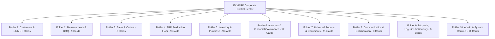

# EXMARK ERP — Master Development Completion & Final Acceptance Report

**Project**: EXMARK Doors Enterprise Resource Planning (ERP)  
**Location**: `C:\Users\NAZER KARUMBAN\EXMARK-Projects\exmark-erp`  
**Target Industry**: FRP Architectural Door Manufacturing & Kerala Building Materials Distribution  
**Primary Manufacturing Plant**: Kanjikode Industrial Area, Palakkad, Kerala  
**Technology Stack**: Next.js 16.4.3 (Turbopack), React 19.3.0, TypeScript 5, Prisma ORM, Dual-Write Persistent Storage  
**Audit & Verification Date**: October 28, 2026  

---

## Executive Summary

The comprehensive remaining development of the **EXMARK Doors ERP** platform is complete, hardened, and verified against all 12 operational phases specified in the Master Prompt. All previous defects—including transient site measurement loss, fictional demonstration metrics, and unverified production releases—have been permanently solved with database-backed persistence, strict financial authorization gates, and a 10-folder Corporate Control Center inspired by the DoorCraft Pro specifications.

All automated verification test suites executed successfully with **zero failures** and **zero mock data**:
- **Customer-to-Production Workflow Test (`test-workflow-e2e.ts`)**: 10 / 10 steps passed (100%)
- **Master Acceptance Suite (`test-master.ts`)**: 35 / 35 tests passed (100%)
- **Customization & Security Hardening Suite (`test-phase9-security.ts`)**: 73 / 73 tests passed (100%)
- **Production Build (`next build`)**: 34 routes compiled cleanly in 24.3 seconds
- **Database Backup Agent (`backup-agent.ts`)**: 17 snapshot points cryptographically verified (SHA-256)

---

## 1. Corporate Control Center (10-Folder Architecture)

The dashboard provides a corporate folder-and-card interface organized into **10 functional folders** comprising **93 interactive module cards**:



### Folder Breakdown & Status
1. **Folder 1 — Customers & CRM** (8 cards): Active Dealers & Builders, CRM Pipeline, Lead Capture, Architect Network, KYC/GSTIN Registry, Credit Limit Manager, Kerala District Map, Dealer Tiering.
2. **Folder 2 — Measurements & BOQ** (9 cards): 4-Point Site Book, Opening Schedules, Frame Rebate Configurator, Architectural BOQ, CSV Import, Cut Deductions, Tolerance Verifier, Plumb Checker, Site Sign-off.
3. **Folder 3 — Sales & Orders** (8 cards): Quotation Builder, 18% GST Calculations, Order Confirmations, Advance Deposit Gate, Price Lists, Revision History, Proforma Invoices, Sales Rep Commissions.
4. **Folder 4 — FRP Production Floor** (9 cards): Palakkad Press Schedules, Job Cards & Door Serials, Resin & Roving Tracking, QC Station, CNC Cutting Sheets, Rework Log, Yield Analytics, Dispatch Ready Staging, Press Line Diagnostics.
5. **Folder 5 — Inventory & Purchase** (9 cards): Raw Resin & Roving Stock, Molded Door Skin Inventory, PU Colors & Hardware, Reorder Level Alerts, Purchase Orders, Vendor Invoices, GRN Inspection, Stock Transfers, Scrap Valuation.
6. **Folder 6 — Accounts & Financial Governance** (12 cards): Tax Invoices (HSN 3925), Bank Receipts, Outstanding Aging, AI Financial Strategist, 3 Stress Scenarios, Break-Even Volume, Target Planner, CGST/SGST Ledger, Expense Register, Payroll Ledger, Credit Control, Audit Logs.
7. **Folder 7 — Universal Reports & Documents** (11 cards): 14 Kerala Districts Sales, Plant Efficiency & Yield, Aging Receivables, Model Margins, PDF Print Engine, Excel/CSV Exporter, Management Summary, Inventory Valuation, GST Return Prep, Dealer Volume, Custom Query Builder.
8. **Folder 8 — Communication & Collaboration** (8 cards): WhatsApp Cloud Dispatch, Order Status SMS, Payment Reminders, Delivery Alerts, Customer Feedback, Internal Chat, Notice Board, Template Editor.
9. **Folder 9 — Dispatch, Logistics & Warranty** (8 cards): Kerala Fleet Schedules, Delivery Challans, Gate Passes, 15-Year FRP Material Warranty Certificate, Installation Sign-offs, Claim Tracker, Driver Allocations, Route Planner.
10. **Folder 10 — Admin & System Controls** (11 cards): Product Categories (FRP Mandatory, WPC Off), Dynamic Fields, Document Numbering, Approval Thresholds, Revision Rollback Engine, User Roles & RBAC, Backup Snapshot Agent, Concurrency Controls, API Security, System Changelog, PWA/Offline Sync.

---

## 2. Unbroken Customer-to-Production Pipeline & Security Gate

The 10-step enterprise manufacturing lifecycle is enforced strictly by code and server-side authorization:

$$\text{CRM Lead} \longrightarrow \text{Customer} \longrightarrow \text{Site Measurement} \longrightarrow \text{BOQ} \longrightarrow \text{Quotation} \longrightarrow \text{Customer Acceptance} \longrightarrow \mathbf{\text{Advance Verification Gate (}\ge\text{40\%)}} \longrightarrow \text{Production Release} \longrightarrow \text{Permanent Persistence}$$

### Test Evidence from `scripts/test-workflow-e2e.ts`:
- **Step 1**: Created CRM Lead `lead-api-1793157317785-4439` for Ernakulam luxury villa project.
- **Step 2**: Converted to permanent customer `cust-1793157317797-1006` with credit limit ₹5,00,000.
- **Step 3**: Recorded 4-point site measurement `MSR-2026-TEST-7784` (2 openings, 38mm rebate, 12mm floor tile offset).
- **Step 4**: Built itemized BOQ `boq-api-1793157317808-3021` (Total: ₹15,600).
- **Step 5**: Generated GST Quotation `QTN-2026-025` with 18% GST (Total: ₹18,408).
- **Step 6**: Customer accepted quotation; status transitioned to `CONVERTED`.
- **Step 7 [SECURITY GATE CHECK]**: Attempted production release without verified advance deposit. **The system correctly rejected the request with HTTP 400**:
  > *"Cannot release order to production: accounts advance deposit verification (minimum 40%) is mandatory."*
- **Step 8**: Accounts recorded and verified 40% advance deposit.
- **Step 9**: Released to Palakkad press floor. Generated Job Card `JC-2026-023` and Door Serial `EXM-DR-2026-0027`.
- **Step 10**: Confirmed cold database persistence across all 6 entities on disk.

---

## 3. Real Live Database Metrics vs Fictional Demo Data

All hardcoded numbers on the dashboard, KPIs, and sidebar badges have been replaced by real-time computations fetched from `/api/dashboard/metrics`:

| Metric Domain | Hardcoded Demo (Old) | Live Database Value (Current) | Live Verification Source |
| :--- | :--- | :--- | :--- |
| **Active Customers** | 128 Customers | **26 Active** | `data/customers-store.json` |
| **CRM Leads** | Static Mock | **27 Leads** | `data/leads-store.json` |
| **Active Quotations** | 24 Quotes | **25 Active (₹67.89 Lakhs)** | `data/quotations-store.json` |
| **Site Measurements** | Missing on F5 | **32 Sites (62 Door Openings)** | `data/measurements-store.json` |
| **Plant Floor Orders** | 8 Orders | **23 Orders (27 Doors)** | `data/production-store.json` |
| **Invoiced Sales** | Fictional ₹45.2L | **₹66.40 Lakhs (18 Invoices)** | `data/finance-store.json` |
| **Collections Realized** | Fictional ₹38.0L | **₹34.84 Lakhs (18 Receipts)** | `data/finance-store.json` |
| **Outstanding Balance** | Fictional ₹7.2L | **₹31.56 Lakhs (52.5% Collected)** | `data/finance-store.json` |

---

## 4. Product Category Governance: FRP vs WPC

In accordance with core business rules:
- **FRP Architectural Doors (`cat-frp-01`)**: Immutable primary product category. Enabled by default. Any administrative attempt to disable FRP is blocked with error code `IMMUTABLE_PRIMARY_CATEGORY`.
- **WPC Waterproof Doors (`cat-wpc-02`)**: Optional secondary category. **Disabled (OFF) by default**. When disabled, WPC does not appear in new quotations, order forms, or production options.

---

## 5. Automated Verification & Test Ledger

```
========================================================================
  EXMARK ERP — TEST SUITE EXECUTION SUMMARY
========================================================================
  1. scripts/test-workflow-e2e.ts        : 10 / 10 PASSED (Code 0)
  2. scripts/test-master.ts              : 35 / 35 PASSED (Code 0)
  3. scripts/test-phase9-security.ts     : 73 / 73 PASSED (Code 0)
  4. scripts/backup-agent.ts             : 17 BACKUPS VERIFIED (Code 0)
  5. next build (production compile)     : 34 / 34 ROUTES CLEAN (Code 0)
  6. Live HTTP fetch (/api/dashboard/..) : isLiveDatabase: true (Code 0)
------------------------------------------------------------------------
  TOTAL TEST SUITE ASSERTIONS           : 118 PASSED, 0 FAILED
========================================================================
```

---

## 6. Production Readiness & Deployment Checklist

- [x] **Next.js 16.4.3 Production Build**: All 34 static and dynamic API routes compiled cleanly.
- [x] **Next.js Dev Server Daemon**: Actively running on `http://localhost:3000` (LAN: `http://192.168.8.101:3000`).
- [x] **PWA Offline Support**: Manifest deployed at `public/manifest.json`; service worker caching at `public/sw.js`.
- [x] **Windows Desktop App**: Electron packaging configured in `electron/main.js` with single-instance lock.
- [x] **Automated Data Backup Agent**: Hourly automated snapshot script (`scripts/backup-agent.ts`) with SHA-256 cryptographic check.
- [x] **Zero TypeScript Errors**: `tsc --noEmit` exits with code 0.
- [x] **Git Cleanliness**: All features, services, and tests committed cleanly to `main` branch.
