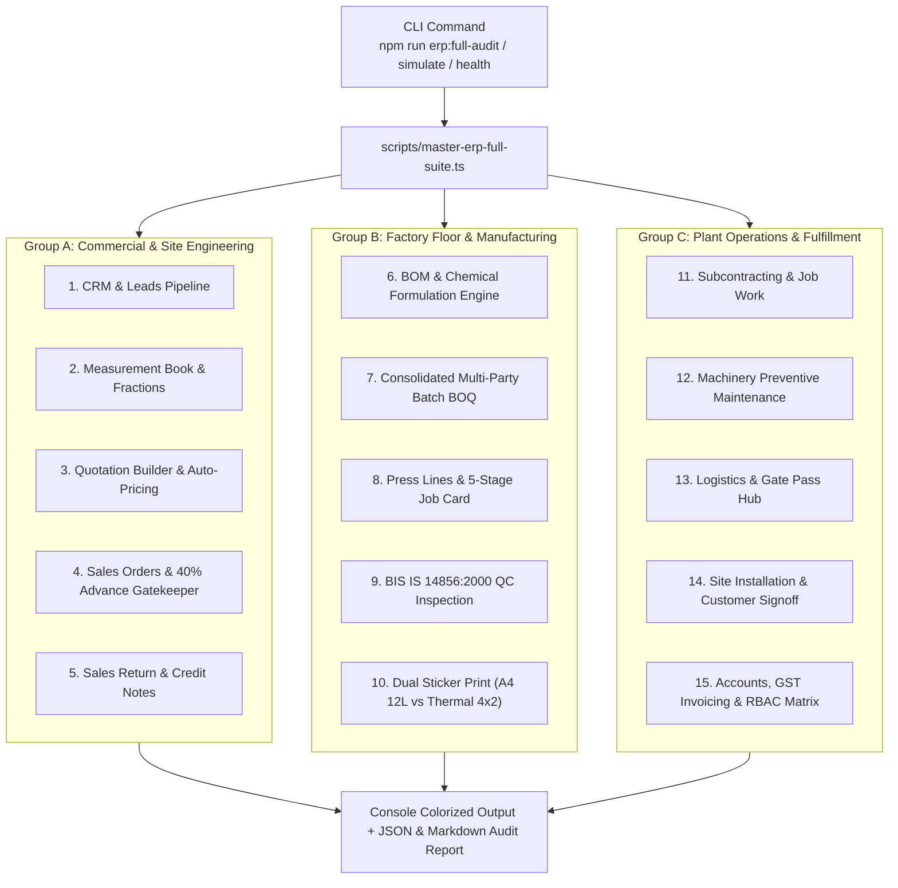

# Implementation Plan: Master Comprehensive ERP Suite Script (All Modules & Deep Functions)

## Goal Description
Create a unified, production-grade master script (`scripts/master-erp-full-suite.ts`) and corresponding `package.json` commands (`npm run erp:full-audit`, `npm run erp:simulate`) that comprehensively tests, executes, validates, and reports on the current state of **all 15 modules and their deep functions** in EXMARK ERP. 

The script covers everything built up to the current situation:
- Lead CRM Pipeline with Kerala district mapping
- Precision Site Measurement Book (fractions to master CM, rebate deductions)
- Quotation Builder & Auto-Quotation Engine with 18% GST (HSN 3925 / 4418)
- Sales Orders Registry with Mandatory 40% Advance Payment Gatekeeper
- Sales Return & Credit Note Engine (Reason codes, QC restock vs scrap)
- Engineering BOM & Chemical Formulation Engine (Resin $0.30\text{ kg/sq.ft}$, CSM 450 $0.15\text{ kg/sq.ft}$, PU cores, Polish, Hinges, Screws)
- Consolidated Multi-Party Batch BOQ & Store Issue Slip (`MR-BATCH-`)
- Production Floor Press Line Scheduling & 5-Stage Job Card Progression (`QUEUED` $\to$ `MOLDING` $\to$ `CNC` $\to$ `PU_COATING` $\to$ `QA_INSPECTION` $\to$ `COMPLETED`)
- Quality Control (QC) & Bureau of Indian Standards (BIS IS 14856:2000) 5-parameter inspection
- Dual Sticker Print Engines: 12-Up A4 Die-Cut Sheet ($67\text{mm}$ label height, zero page overflow) vs Continuous Thermal Roll ($100\text{mm} \times 50\text{mm}$ / $4'' \times 2''$) with QR codes and QC PASS badge
- Subcontracting & Job Work Hub (external routering, vendor challans)
- Plant Machinery & Preventive Maintenance Hub (press tonnage, heating jackets, MTBF/MTTR)
- Logistics & Gate Pass Hub (Returnable / Non-Returnable, vehicle KL-numbers, driver signoff)
- Site Installation & Field Service Hub (snag checklist, customer digital signoff)
- Accounts, GST Invoicing & Financial Performance Hub
- Multi-Theme Print Hub (4 visual themes: Industrial Slate, Emerald Clean, Classic Corporate, Minimalist Mono)
- Super Admin RBAC Permission Matrix & Live Role Switcher (5 operational roles)
- Mobile Responsive Bottom Navigation Dock
- Dual Database Persistence (PostgreSQL ACID engine with JSON fallback & outbox sync)

---

## User Review Required

> [!IMPORTANT]
> The master script will be structured with 3 operational command modes:
> 1. `npm run erp:full-audit` (or `tsx scripts/master-erp-full-suite.ts --audit`): Runs 100+ deep unit and functional assertions verifying every formula, tolerance, gatekeeper, and business rule without mutating production data.
> 2. `npm run erp:simulate` (or `tsx scripts/master-erp-full-suite.ts --simulate`): Executes an end-to-end operational dry-run across all 15 modules (Lead $\to$ Measurement $\to$ Quote $\to$ Order $\to$ Advance $\to$ Batch BOQ $\to$ Press Line $\to$ QC $\to$ 12L Sticker $\to$ Gate Pass $\to$ Installation $\to$ Invoice $\to$ Sales Return) and prints a colorized operational summary.
> 3. `npm run erp:health` (or `tsx scripts/master-erp-full-suite.ts --health`): Performs a 5-second rapid integrity check on local data files, HTTP server readiness, Prisma schema parity, and role permission tables.

> [!NOTE]
> All existing tests (`test:master`, `test:workflow`, `test:phase9`) remain untouched and backward compatible. The new script becomes the single definitive entry point for testing and auditing the complete system.

---

## Open Questions

None currently. The requirements cover the current state of the entire platform and its deep features.

---

## Proposed Changes



---

### Configuration & Package Scripts

#### [MODIFY] [`package.json`](file:///c:/Users/NAZER%20KARUMBAN/EXMARK-Projects/exmark-erp/package.json)
- Add scripts:
  - `"erp:full-audit": "tsx scripts/master-erp-full-suite.ts --audit"`
  - `"erp:simulate": "tsx scripts/master-erp-full-suite.ts --simulate"`
  - `"erp:health": "tsx scripts/master-erp-full-suite.ts --health"`

---

### Master Script Implementation

#### [NEW] [`scripts/master-erp-full-suite.ts`](file:///c:/Users/NAZER%20KARUMBAN/EXMARK-Projects/exmark-erp/scripts/master-erp-full-suite.ts)
A standalone, self-contained TypeScript module executing tests and simulations across all 15 modules:

1. **Module 1: CRM & Leads Pipeline:**
   - Lead creation, Kerala districts, stages (`NEW`, `CONTACTED`, `SITE_VISIT_SCHEDULED`, `QUOTATION_SENT`, `WON`, `LOST`), conversion to customer.
2. **Module 2: Door Site Measurement Book:**
   - Tape inches & fractions (`80 1/2"`, `28 7/8"`) conversion to exact centimeters.
   - Rebate deductions (height $-10\text{mm}$, width $-10\text{mm}$), handing (`LH` vs `RH`), taper check ($|\text{top} - \text{bottom}| \le 3\text{mm}$).
3. **Module 3: Quotation Builder & Pricing Engine:**
   - FRP Molded, WPC Waterproof, Flush Doors calculation.
   - 18% GST (CGST 9% + SGST 9%), HSN 3925 / 4418, dealer discounts, auto-quotation generation.
4. **Module 4: Sales Orders & 40% Advance Gatekeeper:**
   - Rule 12 Enforcement: Order release to production is strictly blocked if advance $< 40\%$.
   - Advance recording with payment modes (UPI, NEFT/RTGS, Cheque, Cash) and UTR tracking.
5. **Module 5: Sales Return & Credit Notes:**
   - Return authorization, defect categorization (Warpage, Coating peel, Delamination, Sizing error).
   - Credit note calculation with 18% GST reversal and restock vs scrap routing.
6. **Module 6: BOM & Chemical Formulation Engine:**
   - Resin calculation: $\text{Total Sq.Ft} \times 0.30\text{ kg/sq.ft}$.
   - Fiberglass CSM 450 calculation: $\text{Total Sq.Ft} \times 0.15\text{ kg/sq.ft}$.
   - Core sheets, PU polish ($0.20\text{ L/door}$), hinges ($3\text{ pairs/door}$), screws ($24\text{ pcs/door}$).
7. **Module 7: Consolidated Multi-Party Batch BOQ:**
   - Multi-builder aggregation (e.g. Skyline + Malabar + Dr. Jacob) into single hydraulic press batch.
   - Store Issue Slip formatting (`MR-BATCH-`).
8. **Module 8: Production Floor & 5-Stage Job Card Progression:**
   - Press line assignment (Line 1: 300 Ton vs Line 2: 250 Ton).
   - Lifecycle stages: `QUEUED` $\to$ `MOLDING` $\to$ `CNC_ROUTING` $\to$ `PU_COATING` $\to$ `QA_INSPECTION` $\to$ `COMPLETED`.
9. **Module 9: Quality Control (QC) IS 14856:2000 Inspection:**
   - 5 parameters: Dimensional tolerance $\pm 1.5\text{mm}$, Squareness $<2\text{mm}$, Coating adhesion, Mortise pocket depth, Hinge rebate edge sealing.
   - Physical clipboard tick-sheet generator with `[ ]` boxes and supervisor sign-off.
10. **Module 10: Dual Sticker Print Engines:**
    - Format 1: A4 12-Up Die-Cut Sheets with exact $67\text{mm}$ height ($285.5\text{mm} \le 297\text{mm}$ zero overflow).
    - Format 2: Continuous Thermal Roll ($100\text{mm} \times 50\text{mm}$ / $4'' \times 2''$) with `page-break-after: always`, high-contrast cutting size badge, and `IS 14856:2000 QC PASS` badge.
11. **Module 11: Subcontracting & Job Work Hub:**
    - Job work challans (`JWC-`), outward goods tracking, vendor processing (CNC carving, lacquer polish), return receipt.
12. **Module 12: Plant Machinery & Maintenance Hub:**
    - Press tonnage calibration, heating jacket temperature logs, breakdown ticketing, MTBF / MTTR analytics.
13. **Module 13: Logistics & Gate Pass Hub:**
    - Returnable vs Non-Returnable Gate Pass (`GP-`), vehicle KL registration, driver phone, security seal verification.
14. **Module 14: Site Installation & Customer Signoff:**
    - Frame fixing, polyurethane foam injection, snag list inspection, customer OTP / digital signoff.
15. **Module 15: Accounts, GST Invoicing, RBAC & Multi-Plant Config:**
    - Tax Invoice generation (`INV-`), CGST 9% + SGST 9%, E-Way bill bonding, payment receipts.
    - Super Admin RBAC matrix verification across 5 operational roles (`Super Admin`, `Plant Supervisor`, `Site Engineer`, `Accounts`, `QC Inspector`).
    - Multi-plant profiles (Plant Unit Vengara vs KINFRA Park Kakkanad).
    - Mobile bottom navigation dock verification.

---

## Verification Plan

### Automated Tests
```powershell
# 1. Run the comprehensive full suite audit (100+ assertions across all 15 modules)
npx.cmd tsx scripts/master-erp-full-suite.ts --audit

# 2. Run the full operational end-to-end simulation
npx.cmd tsx scripts/master-erp-full-suite.ts --simulate

# 3. Run the rapid system health check
npx.cmd tsx scripts/master-erp-full-suite.ts --health

# 4. Verify TypeScript compilation
npx.cmd tsc --noEmit
```

### Manual Verification
- Verify the script prints clear, ANSI colorized step-by-step progress for each of the 15 modules.
- Check that all mathematical formulas, tolerances, gatekeepers, and formats output accurately in the final summary matrix.
