# Master Implementation Plan: EXMARK Doors Factory ERP, CRM & Production Floor Integration

## Executive Overview
The user provided the complete standalone single-file production prototype `exmark_doors_factory_erp_crm_production_floor.html`. This document defines the engineering and operational workflow for Kerala's FRP and WPC door manufacturing plants.

This plan details the implementation strategy to:
1. **Preserve & Deploy Standalone Web Prototype:** Save the complete interactive single-file suite directly to `public/factory-floor-prototype.html` so it can be accessed in any browser at `http://localhost:3000/factory-floor-prototype.html` with zero dependencies.
2. **Upgrade Desktop Workstation Renderer (`electron/index.html`):** Replace the desktop renderer with this unified suite, retaining the Electron context bridge (`window.electronAPI`), automatic localhost/offline fallback, and zero blank-screen resilience.
3. **Harmonize Full-Stack Next.js Components & APIs:** Verify that all 15 modular React views in `components/modules/` and backend API endpoints mirror the exact data attributes, tolerance formulas, 40% advance gatekeeping, dual sticker printing formats, and multi-party batch BOQ calculations.

---

## Technical Architecture & Workflow Pipeline

```mermaid
flowchart LR
    A["1. Quotation<br/>(₹ Price & Specs)"] -->|"Client Approval"| B["2. Measurement Book<br/>(Tape & Tolerances)"]
    B -->|"Lock & Convert"| C["3. Sales Order<br/>(40% Advance Gate)"]
    C -->|"Accounts Verify"| D["4. BOM & Material Store<br/>(Consolidated Batch BOQ)"]
    D -->|"Store Issue Slip"| E["5. Plant Floor Press<br/>(5-Stage Job Card)"]
    E -->|"QC Pass (IS 14856)"| F["6. 12L Stickers / Thermal<br/>& Tax Invoice"]
```



---

## Detailed Implementation Workstreams

### Workstream 1: Standalone Public Showcase & Quick Access
* **File Target:** `public/factory-floor-prototype.html`
* **Purpose:** Allows instant demonstration, tablet floor deployment, and zero-setup browser testing.
* **Key Components Included:**
  * Complete Tailwind CSS configuration with EXMARK brand colors (`brand.red`, `brand.darkBg`, `brand.cardBg`).
  * CSS print rules for:
    - **A4 12-Up Sheet (12L Compact):** Exact 67mm card height, 3 cols × 4 rows (12 per page), zero overflow.
    - **Single Thermal Roll (4" × 2" / 100mm × 50mm):** Continuous roll thermal printer output (`page-break-after: always`).
  * Live JavaScript state machine managing customers, sales orders, invoices, vouchers, leads, and tolerance formulas.

---

### Workstream 2: Electron Desktop Workstation Upgrade
* **File Target:** `electron/index.html` and `electron/main.js`
* **Purpose:** Ensure the packaged Windows EXE and desktop workstation launch into this exact unified interface with native desktop capabilities.
* **Integrations to Embed:**
  1. **Electron Preload Bridge:**
     ```javascript
     if (window.electronAPI) {
       // Support IPC methods: getServerUrl, setServerUrl, retryConnection, printPage
     }
     ```
  2. **Smart Localhost Auto-Detection:**
     Proactively probe `http://127.0.0.1:3000/api/health` and `http://localhost:3000/api/health` upon `DOMContentLoaded`. If active, automatically route network mutations through the local Next.js server.
  3. **Offline Fallback Buffer:**
     If the central server is unreachable, persist records to the local workstation cache (`localStorage` / `sessionStorage`) with zero blank-screen freezes.
  4. **Native Printing Integration:**
     Wire `triggerPrintBtn` directly to `window.print()` or `electronAPI.printPage()`.

---

### Workstream 3: Full-Stack Feature Alignment in Next.js Modules

| Feature Module | Prototype Specification | Next.js Component Alignment |
| :--- | :--- | :--- |
| **1. Super Admin RBAC Modal** | Matrix of 5 roles × 8 modules with live toggling | `components/settings/AdminCustomizationSettings.tsx` & `lib/auth/roles.ts` |
| **2. Advance Deposit Gatekeeper** | Mandatory 40% advance before unlocking "Release to Press" | `components/modules/sales/RecordAdvanceModal.tsx` & `app/api/orders/route.ts` |
| **3. Precision Door Measurement** | Tape (inch + nool) to master factory CM with 4-point frame inputs and rebate/clearance deductions | `components/modules/DoorMeasurementModal.tsx` & `lib/services/measurementService.ts` |
| **4. Dual Format Sticker Printing** | Format 1: A4 12-Up Sheet (67mm high)<br/>Format 2: Single Thermal Roll (4"×2" / 100×50mm) | `components/modules/production/BatchPrintHub.tsx` & `components/modules/reports/ReportPrintDocumentHub.tsx` |
| **5. Multi-Party Consolidated BOQ** | Multi-order checkbox selection calculating total batch resin, fiber, and core requirements | `components/modules/engineering/BomAndRecipeHub.tsx` & `components/modules/ModuleViews.tsx` |
| **6. IS 14856:2000 QC Checklist** | Digital checklist + printable physical clipboard sheet with `[ ]` tick-boxes | `components/modules/quality/QualityControlHub.tsx` |
| **7. Accounts & Vouchers** | Payment IN (വരവ്) & Payment OUT (ചെലവ്) with GST Tax Invoices | `components/modules/finance/PaymentReceiptModal.tsx` & `types/finance.ts` |

---

## Verification & Acceptance Criteria

1. **Standalone Prototype Access:**
   - Navigating to `http://localhost:3000/factory-floor-prototype.html` loads the complete interactive interface with all modals, tabs, and styles functioning.
2. **Desktop Workstation Loading:**
   - Launching `electron/index.html` displays the updated UI with 0 DOM parser errors and functioning Electron IPC bridge.
3. **Workflow Bonding Verification:**
   - Quotation approval smoothly transfers party, sizes, and models to the Door Measurement Book.
   - Saving measurements computes exact shutter CM sizes and creates/bonds into a Sales Order.
   - Sales Order strictly blocks release to press until ≥ 40% advance is verified.
   - Releasing order generates both individual and consolidated batch BOQ slips.
   - Dispatch readiness allows generating 18% GST Tax Invoices.
4. **Printer Output Verification:**
   - A4 12-Up Sheet prints exactly 12 stickers per page with no trailing spillover.
   - Thermal Roll preview prints individual labels with barcode and IS 14856:2000 PASS badge.
5. **Codebase Integrity:**
   - `npm run erp:full-audit` achieves 70/70 assertions (100%).
   - `npx tsc --noEmit` produces 0 errors.

---

## User Decision & Feedback Request
Please review this implementation plan. Once approved by clicking **Proceed**, we will deploy the standalone prototype to `public/factory-floor-prototype.html`, update `electron/index.html` with Electron API bridging, verify all React modules, and run the complete test suite.
