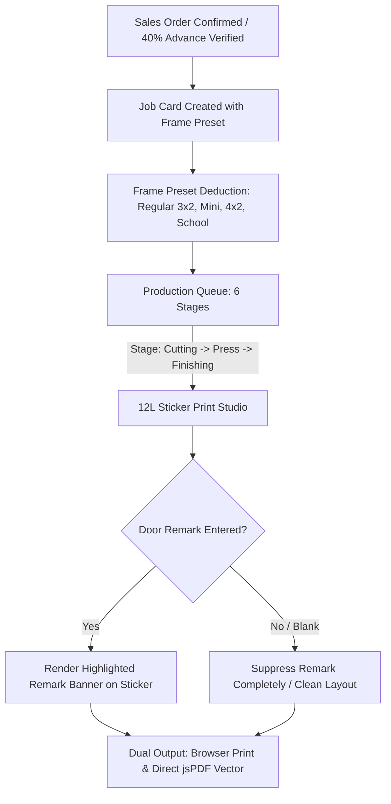

# Implementation Plan: Antigravity Factory Production & Industrial 12L Sticker Suite Integration

## Goal Description
Integrate the factory production floor capabilities, industrial 12L sticker generator, and precision frame deduction engine from the uploaded `antigravity-factory-production-suite_(1).zip` into the unified **EXMARK ERP** application.

Specifically, this integration introduces:
1. **Strict Conditional Remark Logic in 12L Stickers**:
   > *"Remark in 12L STICKER WHEN I TYPE SOMETHING IN REMARK COLUMN ONLY OTHERWISE REMARK WILL BE BLANK"*
   When a user types a remark for a door, an alert badge/box is printed. When left empty, the remark field is completely suppressed—leaving clean, uncluttered white space.
2. **Direct Vector jsPDF Engine**: Direct client-side download of pixel-perfect A4 12-Up sticker sheets (2 cols $\times$ 6 rows: 105mm $\times$ 48mm or 3 cols $\times$ 4 rows: 70mm $\times$ 74mm) with QR codes, barcode numbers, and factory specs.
3. **Architectural Frame Deduction Presets**:
   - `Regular 3x2` (7mm width, 14mm height deduction)
   - `Mini Type` (6mm width, 12mm height deduction)
   - `Bedroom 4x2` (8mm width, 15mm height deduction)
   - `Bedroom 2x2.5` (7mm width, 14mm height deduction)
   - `School 90x45` (8mm width, 16mm height deduction)
   - Automated hinge positions ($150\text{mm}$, midpoint, $\text{height} - 200\text{mm}$), standard lock center ($1000\text{mm}$), square feet and running feet calculations.
4. **Interactive 6-Stage Production Queue**:
   $\text{Cutting} \longrightarrow \text{Assembly} \longrightarrow \text{Hydraulic Press} \longrightarrow \text{Finishing/PU} \longrightarrow \text{QC Inspection} \longrightarrow \text{Dispatched}$
   with urgency flags (`Urgent`, `Express`, `Normal`) and one-click sticker generation from any job card.

---

## User Review Required

> [!IMPORTANT]
> **No Separate Measurement Book**: In accordance with the previous user instruction to remove the Door Measurement module, these frame deduction presets and sizing calculations are embedded directly into **Quotations**, **Sales Orders**, and **Production Job Cards**, preserving the clean direct flow:
> $$\text{Quotation} \longrightarrow \text{Sales Order (40\% Adv Lock)} \longrightarrow \text{BOM \& Store} \longrightarrow \text{Plant Press} \longrightarrow \text{Tax Invoice}$$

> [!NOTE]
> **Dual Sticker Output Preserved**:
> 1. In-browser HTML Print Dialog (with `@media print` CSS for immediate printing to physical office/A4 printers and thermal roll printers).
> 2. Direct **Download Vector jsPDF** button (using the new `PrintEngine.ts` vector rendering for saving/archiving clean PDF sheets).

---

## Architectural Workflow



---

## Proposed Changes

### Component 1: Precision Frame Deduction & Sizing Engine

#### [NEW] `lib/services/doorSizingEngine.ts`
- Port `src/utils/DoorMeasurementEngine.ts` and `scripts/antigravity_door_measurement.py` into a robust TypeScript module.
- Define `FRAME_PRESETS` with exact deductions:
  ```typescript
  export type FramePresetKey = 'regular_3x2' | 'mini' | 'bedroom_4x2' | 'bedroom_2x2_5' | 'school_90x45';

  export interface FramePresetConfig {
    name: string;
    widthDeductionMm: number;
    heightDeductionMm: number;
    description: string;
  }

  export const FRAME_PRESETS: Record<FramePresetKey, FramePresetConfig> = {
    regular_3x2: { name: 'Regular 3x2', widthDeductionMm: 7, heightDeductionMm: 14, description: 'Standard residential WPC/wood rebate' },
    mini: { name: 'Mini Type', widthDeductionMm: 6, heightDeductionMm: 12, description: 'Compact bathroom & utility door frames' },
    bedroom_4x2: { name: 'Bedroom 4x2', widthDeductionMm: 8, heightDeductionMm: 15, description: 'Heavy timber / wide rebate frames' },
    bedroom_2x2_5: { name: 'Bedroom 2x2.5', widthDeductionMm: 7, heightDeductionMm: 14, description: 'Standard apartment door frames' },
    school_90x45: { name: 'School 90x45mm', widthDeductionMm: 8, heightDeductionMm: 16, description: 'Institutional heavy-duty frames' },
  };

  export function calculateDoorSpecs(params: {
    frameWidthMm: number;
    frameHeightMm: number;
    presetKey?: FramePresetKey;
  }) { ... }
  ```

---

### Component 2: Vector PDF Sticker Generator

#### [NEW] `lib/utils/pdfStickerEngine.ts`
- Port `src/components/PrintEngine.ts` into Next.js/Electron compatible vector generator using `jspdf`.
- Implements exact 2-column $\times$ 6-row (105mm $\times$ 48mm) A4 layout and 3-column $\times$ 4-row (70mm $\times$ 74mm) layout.
- Implements the strict conditional remark logic:
  ```typescript
  const hasRemark = item.remark && item.remark.trim().length > 0;
  if (hasRemark) {
    doc.setFillColor(254, 243, 199);
    doc.setDrawColor(245, 158, 11);
    doc.roundedRect(x + 3, y + 34, labelWidth - 6, 7.5, 1, 1, 'FD');
    doc.setTextColor(180, 83, 9);
    doc.setFontSize(6.5);
    doc.text('REMARK:', x + 5, y + 38.5);
    doc.setTextColor(15, 23, 42);
    doc.setFontSize(7);
    doc.text(item.remark.trim().slice(0, 48), x + 20, y + 38.5);
  }
  // When empty, remark is completely omitted!
  ```

---

### Component 3: 12L Batch Print Hub Upgrade

#### [MODIFY] `components/modules/production/BatchPrintHub.tsx`
- Add door-by-door editable remark column in the batch order inspector:
  - Text input: `Door Remark (e.g. "Customer Special Handle Groove")`.
  - Placeholder: `Leave blank for no remark box`.
- In HTML print preview & printable document:
  - If `st.remark && st.remark.trim().length > 0`: display the yellow/amber remark box.
  - If `!st.remark`: completely suppress the remark box.
- Add **"Download 12L Vector PDF"** button calling `generate12LStickerPdf`.
- Add frame preset selector dropdown on each door row.

---

### Component 4: Production Floor 6-Stage Queue

#### [MODIFY] `components/modules/production/ProductionFloorQueue.tsx` / `ProductionView` in `components/modules/ModuleViews.tsx`
- Upgrade production job cards to support the 6 stages from the suite:
  1. `Cutting & Sizing`
  2. `Assembly & Core Insertion`
  3. `Hydraulic Hot Press`
  4. `PU Polish & UV Coating`
  5. `IS 14856:2000 QC Inspection`
  6. `Ready for Dispatch / Dispatched`
- Add priority badges (`Urgent`, `Express`, `Normal`).
- Direct action: `Print 12L Stickers` button on each card, opening the 12L Print Hub pre-loaded with the job's doors.

---

### Component 5: Full Suite Audit & Regression Testing

#### [MODIFY] `scripts/master-erp-full-suite.ts`
- Add automated assertions for:
  - Frame deduction presets calculation ($7/14\text{mm}$, $6/12\text{mm}$, $8/15\text{mm}$, $8/16\text{mm}$).
  - Strict conditional remark behavior in 12L sticker generation.
  - Vector jsPDF generator initialization.
  - Production 6-stage queue progression.

---

## Verification Plan

### Automated Tests
1. **TypeScript Type Check**:
   ```powershell
   npx.cmd tsc --noEmit
   ```
   *Expected*: 0 errors.

2. **Master ERP Full Suite Audit**:
   ```powershell
   npm.cmd run erp:full-audit
   ```
   *Expected*: All assertions pass (100%).

3. **HTTP Endpoint Verification**:
   ```powershell
   node -e "fetch('http://localhost:3000').then(r => console.log('HTTP Status:', r.status));"
   ```
   *Expected*: `HTTP Status: 200`.

### Manual Verification
1. Navigate to **12L Stickers & Batch** in the web dashboard or Electron desktop app.
2. Select an order. Type a remark (e.g. *"Customer Special Handle Groove"*) for Door #1; leave Door #2 remark blank.
3. Verify that Door #1 sticker displays the yellow remark box, while Door #2 sticker completely omits the remark box and remains clean.
4. Click **Download 12L Vector PDF** and verify the generated PDF has both doors formatted cleanly.
5. In **Production Floor**, advance an order through the 6 stages and click **Print Job Stickers**.
