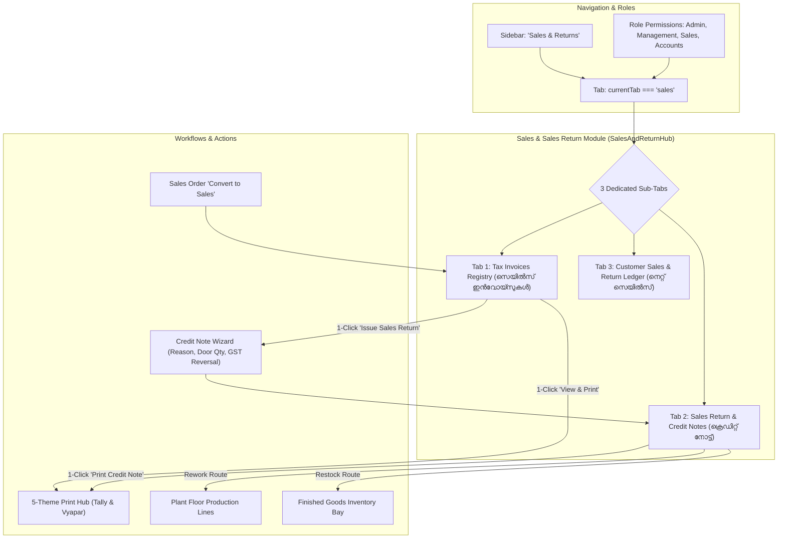

# Implementation Plan: Dedicated Sales & Sales Return Module

This plan establishes a dedicated, standalone **Sales & Sales Return Module** (`sales`) in EXMARK ERP, accessible directly from the primary navigation sidebar and corporate module hub. It provides comprehensive management for GST Tax Invoices, Sales Returns, Credit Notes (GST Section 34), factory rework routing, and net sales reconciliation.

---

## 1. Goal Description

Currently, quotations and work orders exist in `quotations` and `sales-orders`. However, standard manufacturing accounting (Tally, Vyapar, SAP) requires a dedicated **Commercial Sales & Returns Management Hub** where:
1. **Sales Registry (ടാക്സ് ഇൻവോയ്സ്):** All converted sales orders and direct commercial sales are tracked as official GST Tax Invoices (`INV-2026-xxx`) with HSN 3925, 18% GST (CGST 9% + SGST 9%), advance deductions, and receivable balances.
2. **Sales Return & Credit Notes (സെയിൽസ് റിട്ടേൺ / ക്രെഡിറ്റ് നോട്ട്):** A full GST Credit Note workflow (Section 34 of CGST Act) to record customer returns (sizing tolerance mismatch, transit surface scratches, lock/hinge variations, or client design changes), calculate tax reversals, and route returned doors to factory rework, inventory restocking, or write-off.
3. **Net Sales Reconciliation:** Live financial overview computing:
   $$\text{Net Billed Sales} = \text{Gross Billed Invoices} - \text{Sales Returns (Credit Notes)}$$
4. **5-Theme Print Hub Integration:** Instant 1-click printing of both **Tax Invoices** and **Credit Notes** in all 5 verified formats (Tally Classic, Tally Modern, Tally Formal, Vyapar Elegant, Vyapar Modern).

---

## 2. Architecture & Data Flow



---

## 3. Data Models & Interfaces

```typescript
// Sales Invoice Record
export interface SalesInvoice {
  id: string; // e.g. "INV-2026-101"
  orderRef?: string; // e.g. "SO-2026-101"
  customerName: string;
  phone: string;
  location: string;
  district: string;
  date: string;
  dueDate: string;
  itemsSummary: string;
  doorsCount: number;
  subtotal: number; // Taxable Value (HSN 3925)
  cgst: number; // 9%
  sgst: number; // 9%
  gstAmount: number; // 18%
  grandTotal: number;
  advanceCredited: number;
  balanceDue: number;
  paymentStatus: 'PAID' | 'PARTIAL' | 'UNPAID';
  eWayBillNo?: string;
  vehicleNo?: string;
}

// Sales Return / Credit Note Record (GST Section 34)
export interface SalesReturnCreditNote {
  id: string; // e.g. "CN-2026-001"
  invoiceRef: string; // e.g. "INV-2026-101"
  customerName: string;
  district: string;
  returnDate: string;
  doorsReturned: number;
  doorModelCode: string;
  returnReason: 
    | 'SIZE_TOLERANCE_MISMATCH'
    | 'TRANSIT_SURFACE_DAMAGE'
    | 'LOCK_HINGE_MISALIGNMENT'
    | 'CLIENT_DESIGN_CHANGE'
    | 'FACTORY_QC_REJECT';
  taxableRefund: number;
  cgstReversal: number;
  sgstReversal: number;
  totalCreditAmount: number;
  disposition: 'REWORK_PLANT_FLOOR' | 'RESTOCK_INVENTORY' | 'SCRAP_WRITE_OFF';
  status: 'DRAFT' | 'APPROVED' | 'CREDIT_ISSUED' | 'LEDGER_ADJUSTED';
  notes?: string;
}
```

---

## 4. Proposed Changes

### Component 1: Core Navigation & Roles
#### [MODIFY] `types/erp.ts`
- Add `'sales'` to `NavigationTab` union:
  ```typescript
  export type NavigationTab =
    | 'dashboard'
    | 'customers'
    | 'crm'
    | 'quotations'
    | 'measurements'
    | 'sales-orders'
    | 'sales' // <-- Standalone Sales & Returns module
    | 'production'
    ...
  ```

#### [MODIFY] `components/layout/Sidebar.tsx`
- Add dedicated `sales` navigation item under 'Core' category with `ReceiptIndianRupee` icon:
  ```typescript
  { id: 'sales', label: 'Sales & Returns', icon: ReceiptIndianRupee, badge: 'GST Billed', category: 'Core' }
  ```

#### [MODIFY] `lib/auth/roles.ts`
- Include `'sales'` module under allowed modules for `Super Admin`, `Management`, `Sales`, and `Accounts`.

#### [MODIFY] `components/dashboard/CorporateModulesHub.tsx`
- Add `Sales & Sales Returns Hub` card into `MODULES_DIRECTORY` under `CORE` commercial category.

---

### Component 2: New Sales & Sales Return Hub
#### [NEW] `components/modules/sales/SalesAndReturnHub.tsx`
Create a comprehensive, responsive dark-theme module component featuring:
1. **Module Header & KPI Summary Bar:**
   - Total Gross Sales (₹)
   - Total Returns / Credit Notes (₹)
   - Net Billed Sales (₹)
   - Pending Receivables (₹)
   - Quick Action: `+ Create Direct Sales Invoice` & `+ Record Sales Return (Credit Note)`
2. **Sub-Tab 1: Sales Invoices Registry:**
   - Filterable search bar (by Invoice #, Customer, District, Status)
   - Detailed rows with Invoice #, Date, Customer & Kerala District, Door Count, Tax Breakdown (HSN 3925, CGST, SGST), Total, Balance Due
   - Action buttons:
     - **View & Print 📄** (opens Print Hub)
     - **Issue Return (Credit Note) ↩** (pre-fills return wizard)
     - **WhatsApp Share 📲**
3. **Sub-Tab 2: Sales Return & Credit Notes (GST Section 34):**
   - Active Credit Notes list with return reasons, door quantities, refund amount, and factory disposition
   - Modal to record new returns:
     - Invoice lookup
     - Door quantity and reason selector
     - Auto-calculates 18% GST tax reversal
     - Selection of factory disposition: *Send to Plant Floor for Resizing*, *Restock in Warehouse*, or *Scrap*
   - 1-Click Print Credit Note
4. **Sub-Tab 3: Customer Reconciliation & Net Sales Ledger:**
   - Per-dealer / builder statement table displaying Gross Invoices, Returns, Net Billed, and Balance
   - 1-Click "View Party Statement" linking directly to the Print Hub in statement theme

---

### Component 3: Print Hub Credit Note Support
#### [MODIFY] `components/modules/quotations/PrintDocumentHub.tsx`
- Add `creditNote` to `DocumentType`:
  ```typescript
  export type DocumentType = 'quotation' | 'proforma' | 'salesOrder' | 'salesInvoice' | 'statement' | 'creditNote';
  ```
- Add Credit Note bilingual titles:
  ```typescript
  creditNote: { en: 'GST CREDIT NOTE (SALES RETURN)', ml: 'ജിഎസ്ടി ക്രെഡിറ്റ് നോട്ട് (സെയിൽസ് റിട്ടേൺ)', badge: 'CREDIT NOTE' }
  ```
- Support Credit Note rendering across all 5 themes (Tally Classic, Tally Modern, Tally Formal, Vyapar Elegant, Vyapar Modern) with reason for return and original invoice references.

---

### Component 4: App Integration
#### [MODIFY] `components/modules/ModuleViews.tsx`
- Export `SalesAndReturnView`:
  ```typescript
  export function SalesAndReturnView() {
    return <SalesAndReturnHub />;
  }
  ```

#### [MODIFY] `app/page.tsx`
- Render `<SalesAndReturnView />` when `currentTab === 'sales'`:
  ```tsx
  {currentTab === 'sales' && <SalesAndReturnView />}
  ```
- Synchronize converted sales orders from QuotationHub into the sales registry.

---

## 5. Verification Plan

### Automated Tests
1. **TypeScript Typecheck:**
   ```powershell
   node_modules\.bin\tsc.cmd --noEmit
   ```
2. **Server Availability:**
   ```powershell
   node -e "const http = require('http'); http.get('http://localhost:3000', (res) => { console.log('STATUS:', res.statusCode); process.exit(0); });"
   ```
3. **Automated Workflow Test Suite:**
   Create and execute `scripts/test-sales-return-workflow.js` verifying:
   - Creation of Sales Invoice and tax breakdown
   - Issuance of Credit Note with GST reversal calculation (Taxable - 18% GST)
   - Net Sales formula validation: $\text{Gross} - \text{Return} = \text{Net}$
   - Factory rework disposition assignment

### Manual Verification
1. Navigate to **"Sales & Returns"** in the sidebar.
2. In **Sales Invoices** tab:
   - Verify converted sales orders appear with Invoice numbers (`INV-2026-xxx`).
   - Click "View & Print" $\to$ verify invoice opens in Print Hub across Tally and Vyapar themes.
3. In **Sales Return & Credit Notes** tab:
   - Click "+ Record Sales Return", pick an invoice, choose reason *"Size Tolerance Mismatch"*, enter 1 door, and choose *"Route to Plant Floor for Resizing"*.
   - Verify Credit Note `CN-2026-xxx` is generated with 18% GST reversal.
   - Verify Net Sales metric updates accordingly.
4. Click "Print Credit Note" $\to$ verify official GST Credit Note format renders cleanly.
