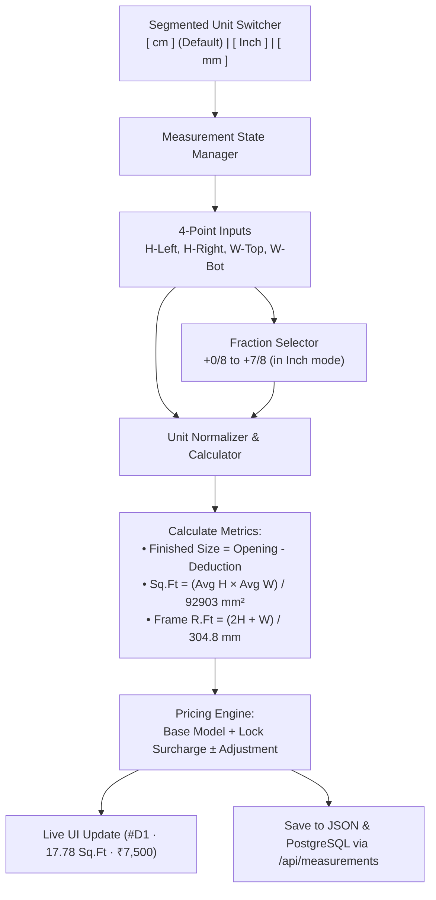

# EXMARK ERP — Site Measurement Unit Selector & Mobile Terminal UI Plan

**Date:** 2026-10-30  
**Feature:** Site Measurement Multi-Unit Input (`cm` default, `Inch` with fractions, `mm`) & Extended Field Measurement Options  
**Target Environments:** Web ERP, Packaged Windows Desktop, Android Mobile APK Field Terminals

---

## 1. Visual Reference & Screenshot Breakdown


Based on the provided screenshot, the site measurement interface requires an enterprise field-terminal design with high contrast, touch-friendly controls, and instant dimensional feedback.

### Key Layout Elements from Reference:
1. **Unit Selector (Top Left):**
   - Segmented buttons: `[ cm ] [ Inch ] [ mm ]`
   - **Default Selected Unit:** `cm`
   - Distinct active styling: High-visibility amber/gold pill (`#F59E0B`) with bold text; inactive units styled in dark slate pills (`#1E293B`).
2. **Party & Mode Header Bar:**
   - `[ Saved Parties ]` / `[ + New Party ]` quick customer link.
   - `[ Profit +0% ]` markup controller.
   - `[ Offline AI + WPC Sheet ]` toggle badge.
   - Live summary badge on the right: `1 pcs · ₹7,500`.
3. **Door Opening Card Header:**
   - Card title: `#D1 · 17.78 Sq.Ft · Frame 16 R.Ft` with live computed price `₹7,500`.
   - 3D/AI preview badge on the left.
4. **Door Model & Preset Dropdowns:**
   - Category / Description: `Bath FRP Door`, `Main Entry Door`, `Bed Room Door`, `Kitchen Water-Shield`.
   - Model & Base Rate: `EXM-A-100 (₹7000)`, `EXM-A-101 (₹7500)`, `EXM-D-200 Luxury (₹9200)`.
   - Size Preset selector: `Mini Size (72×50)`, `Standard (80×32)`, `Custom Masonry`.
5. **4-Point Masonry Measurement Grid:**
   - Four primary inputs:
     - `H-LEFT (CM)` (or `INCH` / `MM` based on active unit)
     - `H-RIGHT (CM)`
     - `W-TOP (CM)`
     - `W-BOT (CM)`
     - `QTY` counter (default: `1`)
   - **Fractional Selector Dropdown** under each measurement:
     - `+ 0/8 (No Frac)`
     - `+ 1/8"` (0.125 in / 3.175 mm)
     - `+ 2/8" (1/4")` (0.250 in / 6.35 mm)
     - `+ 3/8"` (0.375 in / 9.525 mm)
     - `+ 4/8" (1/2")` (0.500 in / 12.7 mm)
     - `+ 5/8"` (0.625 in / 15.875 mm)
     - `+ 6/8" (3/4")` (0.750 in / 19.05 mm)
     - `+ 7/8"` (0.875 in / 22.225 mm)
   - Real-time unit conversions and taper/out-of-plumb warning badges.
6. **Finishes, Locks, and Dual-Tone Options:**
   - `COLOUR / FINISH (PRESET + CUSTOM)`: e.g. `Natural Teak (EXGC-510)`.
   - Dual-tone inside color input: `Inside Colour (ഇൻസൈഡ് കളർ)...` (ideal for bathroom doors with teak exterior and waterproof white interior).
   - `LOCK OPTION (ALL LOCKS + CUSTOM)`: `Baby Latch (+₹200)`, `Mortise Lock 60mm (+₹850)`, `SS Knob Lock (+₹450)`.
7. **Commercial Adjustment & Remarks:**
   - `DOOR PRICE ADJUSTMENT (₹)`: Quick buttons `[-100]`, editable price `[ 7500 ]`, `[+100]` with `[Piece Mode]` / `[Sq.Ft Mode]`.
   - `REMARK / SITE NOTE`: Free-text field for site-specific notes (e.g. "Granite sill rebate required").
8. **Bottom Control Toolbar:**
   - `Handing / Profit` modal launcher.
   - Camera icon with counter `📷 0` for site measurement photos.
   - Voice note / Mic button `🎙️` for recording field notes.
   - Duplicate opening button `📋` (Copy door specs with 1-click).
   - Delete opening button `🗑️`.

---

## 2. Technical Architecture & Unit Conversion Logic



### Unit Conversion Formulas

All internal calculations and cutting deduction logic will remain normalized to standard millimeters (`MM`) for factory hydraulic presses while presenting values to field technicians in their selected unit:

$$\text{From CM to MM:} \quad \text{Value (mm)} = \text{Value (cm)} \times 10$$

$$\text{From Inch to MM:} \quad \text{Value (mm)} = \left(\text{Whole Inches} + \frac{\text{Numerator}}{8}\right) \times 25.4$$

$$\text{From MM to CM:} \quad \text{Value (cm)} = \frac{\text{Value (mm)}}{10}$$

$$\text{From MM to Inch:} \quad \text{Total Inches} = \frac{\text{Value (mm)}}{25.4}$$

$$\text{Square Footage:} \quad \text{Sq.Ft} = \frac{\text{Height (mm)} \times \text{Width (mm)}}{92903.04}$$

$$\text{Frame Running Feet:} \quad \text{R.Ft} = \frac{(2 \times \text{Height (mm)}) + \text{Width (mm)}}{304.8}$$

---

## 3. Data Model Enhancements

In [`types/measurements.ts`](file:///c:/Users/NAZER%20KARUMBAN/EXMARK-Projects/exmark-erp/types/measurements.ts), `DoorItemInput` will be enriched with the screenshot fields:

```typescript
export type MeasurementUnit = 'CM' | 'INCH' | 'MM';

export interface DoorItemInput {
  id?: string;
  doorNumber: string;               // e.g. "#D1"
  categoryName?: string;             // e.g. "Bath FRP Door"
  model: string;                    // e.g. "EXM-A-100 (₹7000)"
  sizePreset?: string;              // e.g. "Mini Size (72×50)"
  frameType: string;                // e.g. "WPC Solid Extruded 100x65mm Frame"
  colour: string;                   // e.g. "Natural Teak (EXGC-510)"
  insideColour?: string;            // e.g. "Inside Colour (ഇൻസൈഡ് കളർ)..."
  hingeSide: string;                // e.g. "Left Hand (LH) - Inward"
  lockType: string;                 // e.g. "Baby Latch (+₹200)"
  lockPrice?: number;               // e.g. 200
  measurementUnit: MeasurementUnit; // Default: 'CM'
  heightLeft: number;
  heightRight: number;
  widthTop: number;
  widthBottom: number;
  // Fractional Inch components
  fractionHeightLeft?: string;      // e.g. "0/8", "1/8", "1/2"
  fractionHeightRight?: string;
  fractionWidthTop?: string;
  fractionWidthBottom?: string;
  quantity: number;                 // Default: 1
  wallThickness?: string;
  rebateDepth?: string;
  priceAdjustment?: number;         // e.g. 0, -100, +100
  basePrice?: number;               // e.g. 7000
  unitPrice?: number;               // e.g. 7500
  pricingMode?: 'PIECE' | 'SQFT';   // Default: 'PIECE'
  calculatedSqFt?: number;          // e.g. 17.78
  calculatedFrameRft?: number;      // e.g. 16
  remarks?: string;                 // e.g. "Site Note..."
  photoCount?: number;
}
```

---

## 4. Implementation Steps

### Phase 1: Update Modal & Core Measurement Components
1. **[`components/modules/DoorMeasurementModal.tsx`](file:///c:/Users/NAZER%20KARUMBAN/EXMARK-Projects/exmark-erp/components/modules/DoorMeasurementModal.tsx):**
   - Change default `measurementUnit` from `'MM'` to `'CM'` in `DEFAULT_DOOR`.
   - Update default dimension values to standard Kerala opening:
     - In `CM`: Height: `210`, Width: `90` (equivalent to 2100mm × 900mm).
     - In `INCH`: Height: `80`, Width: `32` (standard 80″ × 32″).
     - In `MM`: Height: `2100`, Width: `900`.
   - Build the top Segmented Unit Switcher (`[ cm ] [ Inch ] [ mm ]`) with `cm` as default active.
   - When unit changes: Automatically convert existing input values between CM, INCH, and MM smoothly without data loss.
   - Add fractional dropdowns (`+ 0/8 (No Frac)` to `+ 7/8"`) under each of the 4 inputs when in `INCH` mode.
   - Add door card header showing `#D1 · X.XX Sq.Ft · Frame XX R.Ft` and live computed total price.
   - Add dual-tone finish input: `Inside Colour (ഇൻസൈഡ് കളർ)...`.
   - Add Lock option with automatic surcharge (`Baby Latch (+₹200)`).
   - Add price increment/decrement buttons (`[-100] [ 7500 ] [+100]` with `Piece Mode`).
   - Add bottom action bar with Copy, Delete, Mic, and Photo attachment controls.

### Phase 2: Update Desktop Offline Interface (`electron/index.html`)
2. **[`electron/index.html`](file:///c:/Users/NAZER%20KARUMBAN/EXMARK-Projects/exmark-erp/electron/index.html):**
   - Update the Site Measurements section and Cutting Calculator to support the `[ cm ] [ Inch ] [ mm ]` segmented toggle with `cm` as default.
   - Mirror the 4-point card design and fractional inch evaluation in the offline workstation interface.

### Phase 3: Service Layer & Database Sync
3. **[`lib/services/measurementService.ts`](file:///c:/Users/NAZER%20KARUMBAN/EXMARK-Projects/exmark-erp/lib/services/measurementService.ts):**
   - Ensure saving, updating, and exporting site measurements handles new fields (`insideColour`, `fractionHeightLeft`, `priceAdjustment`, `pricingMode`, `calculatedSqFt`, `calculatedFrameRft`).
   - Preserve full backward compatibility with previously stored measurements.

### Phase 4: Automated Testing & Verification
4. **Create Verification Script (`scripts/test-site-measurement-units.ts`):**
   - Test default unit selection is `'CM'`.
   - Test bidirectional unit conversions (`210 cm` = `2100 mm` = `82.68 inch`).
   - Test fractional inch calculation (`80 + 1/2"` = `80.5"` = `204.47 cm` = `2045 mm`).
   - Test live Sq.Ft and Frame R.Ft computations.
   - Test full save and retrieval of measurements with dual-tone colors, lock surcharge, and price adjustments.
   - Run `npm run test:master` to ensure 100% compliance across all 35 ERP acceptance tests.
