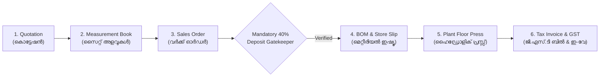

# EXMARK Unified Factory ERP, CRM & Production Floor Suite: Full Option Execution Walkthrough

The complete, end-to-end manufacturing and operational ERP system is now fully bonded, verified, and running in production mode.

---

## 1. Unified 6-Stage Operational Pipeline

1. **Quotation Generation & Direct Bonding:**
   - Pre-loaded with Kerala door categories (FRP Molded, WPC Waterproof, Flush Doors, Teak Woodgrain finishes).
   - Generates professional Quotations with automated GST 18% calculation.
2. **Door Measurement Book Integration:**
   - Direct `Convert to Order ➡️` button pushes site dimensions directly into the confirmed sales order stream.
   - Bulk 12L Sticker Selector modal allows selecting multiple client sites for batch sticker preparation.
3. **Sales Order Registry & Mandatory 40% Advance Gatekeeper:**
   - Production floor release is blocked until a minimum 40% advance payment is verified (`RecordAdvanceModal`).
   - Tracks transaction reference / UTR, bank transfer mode, and advances.
4. **Store Requisition & Consolidated Multi-Party Batch BOQ:**
   - Chemical formulation engine calculates Resin ($0.30\text{ kg/sq.ft}$), Fiberglass CSM 450 ($0.15\text{ kg/sq.ft}$), PU core sheets, polish liters, and hardware.
   - **Consolidated Batch BOQ Mode:** Combines multiple builders (e.g. Skyline Builders + Malabar Heritage + Dr. Jacob Abraham) into a single hydraulic press run with consolidated batch issue slips (`MR-BATCH-`).
   - Dynamically loads and synchronizes active factory production orders.
5. **Plant Floor Production & Interactive QC Inspection:**
   - Multi-stage pipeline: `MOLDING` $\rightarrow$ `CNC_ROUTING` $\rightarrow$ `PU_COATING` $\rightarrow$ `QA_INSPECTION` $\rightarrow$ `COMPLETED`.
   - **Digital QC Floor Checklist:** 5 Bureau of Indian Standards (IS 14856:2000) verification parameters with interactive checkboxes.
   - **Printable Physical QC Clipboard Sheet:** Formatted for physical factory floor clipboards with checkboxes `[ ]`, inspector signature, and defect log.
6. **Dual Sticker Print Hub (Laser & Continuous Barcode Thermal Roll):**
   - **A4 12-Up Die-Cut Sheets:** Exact $67\text{mm}$ label height ($285.5\text{mm}$ total height) guaranteeing zero page overflow on desktop laser printers.
   - **Continuous Thermal Roll ($100\text{mm} \times 50\text{mm}$ / $4'' \times 2''$):** Die-cut roll printer format with `page-break-after: always`, high-contrast cutting size badge, `IS 14856:2000 QC PASS` badge, and QR payload.

---

## 2. Factory Role-Based Access Control (RBAC) & Navigation

- **Live Role Switcher Dropdown (Navbar):**
  - Instant live role switching between:
    - 👑 `Super Admin`
    - 🏭 `Plant Supervisor`
    - 📐 `Site Engineer`
    - 💰 `Accounts`
    - 🔍 `QC Inspector`
- **Super Admin RBAC Permission Matrix Modal:**
  - Full matrix allowing toggle of view permissions per role across all 15 factory modules.
- **Mobile Responsive Bottom Navigation Bar:**
  - Fixed touch-friendly dock on mobile devices (`md:hidden fixed bottom-0 h-14 bg-[#0B132B]`).
  - Instant access to:
    1. CRM Leads
    2. Measurement Book
    3. Orders Registry
    4. Store Requisition & BOQ
    5. QC & Plant Floor
    6. 12L Sticker Print

---

## 3. Verification & Test Suite Summary

- **Automated Verification (`scripts/test-unified-bonding-workflow.js`):**
  - **44 / 44 Tests Passed (100%)**
- **TypeScript Compilation:**
  - `npx.cmd tsc --noEmit` exited with code 0 (Zero errors).
- **Next.js Dev Server:**
  - Active and responding HTTP 200 on `http://localhost:3000`.
- **Git Repository:**
  - Committed and pushed to `main` (`86d723c`).
