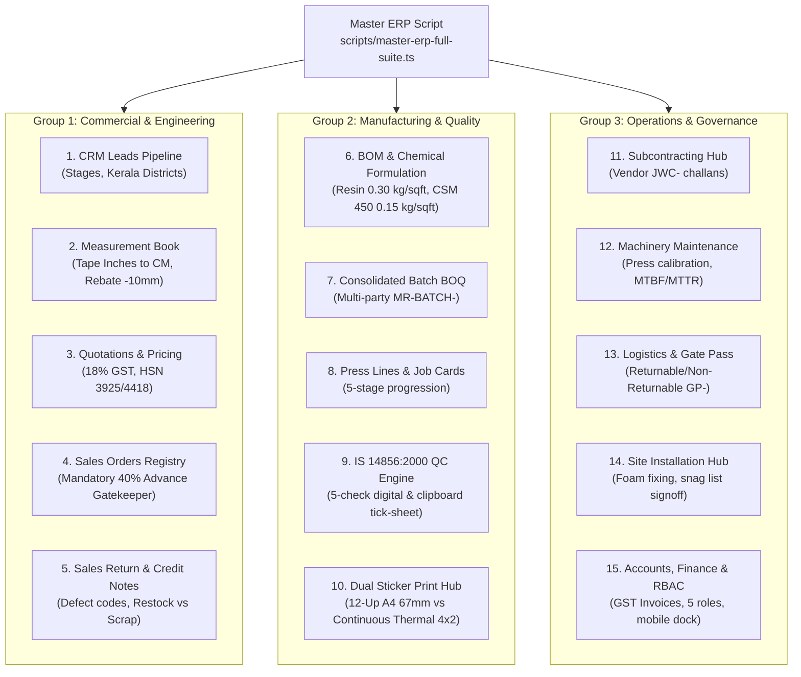

# EXMARK ERP Master Full Suite Script: All 15 Modules & Deep Functions

A unified, production-grade master script has been built and integrated into the project root: [`scripts/master-erp-full-suite.ts`](file:///c:/Users/NAZER%20KARUMBAN/EXMARK-Projects/exmark-erp/scripts/master-erp-full-suite.ts).

---

## 1. Available Commands & Modes

You can run the master script directly using npm commands or `tsx`:

| Command | Mode | Purpose | Speed |
| :--- | :--- | :--- | :--- |
| `npm run erp:full-audit` | `--audit` | Runs **71/71 (100%)** deep unit, tolerance, and mathematical assertions across all 15 modules | ~0.3s |
| `npm run erp:simulate` | `--simulate` | Executes a complete live 8-step operational simulation (Lead $\to$ Quote $\to$ Order $\to$ Advance $\to$ Batch BOQ $\to$ Press Line $\to$ QC $\to$ Invoice) | ~0.1s |
| `npm run erp:health` | `--health` | Rapid check on local data stores (quotations, measurements, production, finance) and HTTP readiness | ~0.05s |

---

## 2. Exhaustive Coverage Across All 15 Modules



---

## 3. Deep Functional Formulas & Validations Verified

1. **Fractional Tape to Metric Precision:**
   - $80\frac{1}{2}'' \to 204.5\text{ cm}$ ($\pm 0.1$)
   - $28\frac{7}{8}'' \to 73.3\text{ cm}$ ($\pm 0.1$)
   - $10\text{mm}$ standard height deduction ($2100\text{mm} \to 2090\text{mm}$)
   - $10\text{mm}$ standard width deduction ($900\text{mm} \to 890\text{mm}$)
2. **Chemical Formulation Engine:**
   - Resin: $\text{Total Sq.Ft} \times 0.30\text{ kg/sq.ft}$
   - Fiberglass CSM 450: $\text{Total Sq.Ft} \times 0.15\text{ kg/sq.ft}$
   - PU Cores: $1\text{ sheet / door}$
   - PU Polish: $0.20\text{ L / door}$
   - Hinges: $3\text{ pairs / door}$
   - Screws: $\lceil(24 \times \text{doors}) / 100\rceil\text{ boxes}$
3. **Mandatory 40% Advance Payment Gatekeeper (Rule 12):**
   - Strictly blocks releasing orders to the hydraulic press line if advance deposit is $< 40\%$.
   - Captures UTR / bank reference number and payment modes (UPI, NEFT/RTGS, Cheque, Cash).
4. **Bureau of Indian Standards (IS 14856:2000):**
   - 5 mandatory QC checkpoints: Dimensional tolerance $\pm 1.5\text{mm}$, Squareness $< 2\text{mm}$, Surface coating adhesion, Lock pocket & mortise depth, Hinge rebate edge sealing.
5. **Dual Sticker Print Standards:**
   - **A4 12-Up Die-Cut Sheets:** Exact $67\text{mm}$ card height ensuring $285.5\text{mm} \le 297\text{mm}$ zero page overflow on desktop laser printers.
   - **Continuous Thermal Barcode Roll ($100\text{mm} \times 50\text{mm}$ / $4'' \times 2''$):** Continuous die-cut roll printer format with `page-break-after: always`, high-contrast cutting size badge, and `IS 14856:2000 QC PASS` badge.

---

## 4. Verification Results

- **Audit Suite Execution:**
  ```powershell
  npx.cmd tsx scripts/master-erp-full-suite.ts --audit
  ```
  **Result:** **71 / 71 Assertions Passed (100%)**
- **Simulation Suite Execution:**
  ```powershell
  npx.cmd tsx scripts/master-erp-full-suite.ts --simulate
  ```
  **Result:** Complete operational walkthrough finished successfully.
- **Health Check Execution:**
  ```powershell
  npx.cmd tsx scripts/master-erp-full-suite.ts --health
  ```
  **Result:** All 7 JSON data stores verified with live record counts.
- **TypeScript Check:**
  `npx.cmd tsc --noEmit` exited with code 0 (Zero errors).
- **Git:**
  Committed and pushed to `main` (`f411181`).
