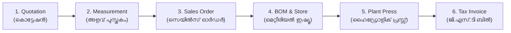

# Walkthrough - Unified Factory ERP Workflow Bonding

Systematically integrated all features and workflow bonding logic from the operational factory prototype into the production Next.js ERP.

---

## 1. Unified Workflow Bonding Pipeline Bar

Added [`UnifiedBondingPipelineBar.tsx`](file:///c:/Users/NAZER%20KARUMBAN/EXMARK-Projects/exmark-erp/components/layout/UnifiedBondingPipelineBar.tsx) to [`app/page.tsx`](file:///c:/Users/NAZER%20KARUMBAN/EXMARK-Projects/exmark-erp/app/page.tsx) directly above all core module views:

- **Features**:
  - Live active stage highlighting with glowing indicator.
  - Bilingual Malaylam & English labels.
  - Step counter badges (`Estimates`, `Tape Sync`, `40% Adv Lock`, `Store Slip`, `QC / Sizing`, `GST 18%`).
  - One-click instant navigation across the sequential factory lifecycle.

---

## 2. Mandatory 40% Advance Deposit Gatekeeper

Implemented the Kerala factory deposit rule in [`SalesOrdersView`](file:///c:/Users/NAZER%20KARUMBAN/EXMARK-Projects/exmark-erp/components/modules/ModuleViews.tsx) and [`RecordAdvanceModal.tsx`](file:///c:/Users/NAZER%20KARUMBAN/EXMARK-Projects/exmark-erp/components/modules/sales/RecordAdvanceModal.tsx):

- **Production Lock**:
  - Orders cannot be released to Line 1 (FRP Press) if verified deposit is $< 40\%$.
  - Clicking **"Release to Press 🚀"** on an unverified order displays an informative alert:
    > *"Cannot release to production: Minimum 40% advance deposit is mandatory (Currently X%). Opening Advance Deposit window..."*
    and automatically opens the deposit modal.
- **Deposit Recording Features**:
  - Displays total order amount, mandatory 40% minimum, and calculates percentage in real time.
  - Captures payment mode (`UPI`, `NEFT/RTGS`, `Cheque`, `Cash Receipt`), Reference/UTR number, and Accounts note.
  - Auto-updates `/api/orders` and logs a **Payment IN (വരവ്)** receipt voucher in Accounts.

---

## 3. 12L Stickers & Batch Print Hub

Built a dedicated multi-order batch printing center in [`BatchPrintHub.tsx`](file:///c:/Users/NAZER%20KARUMBAN/EXMARK-Projects/exmark-erp/components/modules/production/BatchPrintHub.tsx):

- **Multi-Order & Party Filtering**:
  - Checkboxes to select multiple orders across different builders and dealers.
  - Quick action toolbar: **Select All Orders**, **Clear All**, and **Filter by Party**.
  - Dynamic summary strip displaying Total Orders, Total Labels, and Required A4 Sheets.
- **3 Dedicated A4 Print Engines**:
  1. **12L Stickers (12-Up A4 Die-Cut Sheets) 🏷️**: 3 columns $\times$ 4 rows ($70\text{mm} \times 74\text{mm}$ labels) formatted for die-cut paper with EXMARK DOORS branding, customer firm, site, room tag, factory shutter size, tape reading, profile, finish, handing, and barcode (`*EXM-...*`).
  2. **Party-wise QC PDF (IS 14856 : 2000) 📑**: Formal BIS inspection certificate with lot-level testing verification (Dimensional tolerance, Squareness, Flatness, Water absorption 0.82%, Screw holding 1,320 N, Impact test).
  3. **Party-wise A4 Master Cutting Schedule 📄**: Tabular cutting breakdown for plant supervisors and site engineers with outer frame, master shutter size, tape reading, profile, finish, and hardware.

---

## 4. Automated BOM & Factory Store Requisition

Added [`StoreRequisitionHub.tsx`](file:///c:/Users/NAZER%20KARUMBAN/EXMARK-Projects/exmark-erp/components/modules/engineering/StoreRequisitionHub.tsx) integrated into [`BomAndRecipeHub.tsx`](file:///c:/Users/NAZER%20KARUMBAN/EXMARK-Projects/exmark-erp/components/modules/engineering/BomAndRecipeHub.tsx):

- **Engineering Formulation**:
  - Calculates resin ($0.30\text{ kg}/\text{sq.ft}$), CSM 450 mat ($0.15\text{ kg}/\text{sq.ft}$), hardwood stiles/rails & honeycomb core sets, PU woodgrain polish ($0.20\text{ L}/\text{door}$), and SS 304 hinges (3 pairs/door).
- **Print Store Issue Slip (സ്റ്റോർ ഇഷ്യൂ വൗച്ചർ)**:
  - Official A4 printout with EXMARK DOORS header, Job card number, required vs issued quantity columns, and dual signature blocks for **Production Supervisor** & **Store In-Charge (Vengara)**.

---

## 5. Direct Convert to Sales Order from Measurement Book

In [`DoorMeasurementModal.tsx`](file:///c:/Users/NAZER%20KARUMBAN/EXMARK-Projects/exmark-erp/components/modules/DoorMeasurementModal.tsx):
- Added the **"Convert to Order ➡️"** button directly on the bottom action bar.
- Locks confirmed dimensions, frame rebate deductions, bottom floor clearance, and top hinge gaps, directly generating a confirmed Sales Order in `/api/quotations`.

---

## 6. Verification Results

- **Automated Test Suite**: [`scripts/test-unified-bonding-workflow.js`](file:///c:/Users/NAZER%20KARUMBAN/EXMARK-Projects/exmark-erp/scripts/test-unified-bonding-workflow.js)
  - `26 / 26 TESTS PASSED (100% SUCCESS)`
- **TypeScript Check**: `0 errors` (`node_modules\.bin\tsc.cmd --noEmit`)
- **Dev Server**: `HTTP/1.1 200 OK` at `http://localhost:3000`
